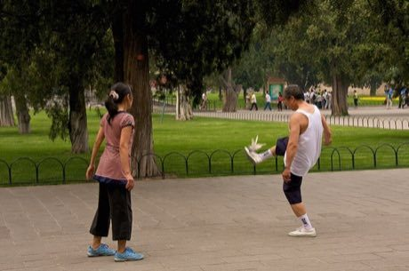

# Jianzi

*Also known as: 毽子 · shuttlecock kicking*

**Encyclopedia ID 1** (permanent) · https://bpupadhyaya.github.io/world-heritage-games-site/games/1-jianzi/

*Photo: Janus Bahs Jacquet from Copenhagen, Danmark, [CC BY-SA 2.0](https://creativecommons.org/licenses/by-sa/2.0/), [source on Wikimedia Commons](https://commons.wikimedia.org/wiki/File:Jianzi_players.jpg)*

Jianzi is a dexterity and skill game tradition from China, Vietnam.

## Heritage note

Part of the living heritage of China, Vietnam, South Korea.

## Origins

Usually placed in the era of Modern Heritage (1800 to today), although its exact origins are uncertain, within the cultural world of China.

## Facts

- **Where:** China, Vietnam, South Korea
- **Type:** Dexterity and skill games
- **Family:** Kicking and football games
- **Era:** [Modern Heritage](../../eras/modern/index.md) (uncertain)
- **Cradle:** [China](../../cradles/china/index.md)
- **Region:** East and Southeast Asia

## Play it

[Try a 90-second preview in your browser](https://bpupadhyaya.github.io/games-site/games/jianzi/play/) · [Google Play](https://play.google.com/store/apps/details?id=com.equalinformation.arcforge.shell) · [App Store](https://apps.apple.com/us/app/arcforge-world-heritage-games/id6813746442)

## Related entries

- [Cuju](../../games/333-cuju/index.md)
- [Nohejbal](../../games/378-nohejbal/index.md)
- [Peteca](../../games/421-peteca/index.md)
- [Sepak takraw](../../games/802-sepak-takraw/index.md)
- [Rugby football](../../games/3686-rugby-football/index.md)
- [Chapteh shuttlecock](../../games/1066-chapteh-shuttlecock/index.md)

## Sources

- <https://commons.wikimedia.org/wiki/File:Jianzi_players.jpg>
