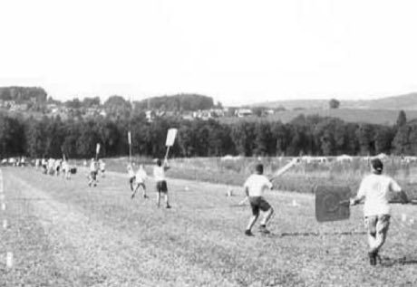

# Hornussen

**Encyclopedia ID 10** (permanent) · https://bpupadhyaya.github.io/world-heritage-games-site/games/10-hornussen/

*Photo: Urs Vonhuben, Hornussergesellschaft, [Public domain](https://creativecommons.org/publicdomain/mark/1.0/), [source on Wikimedia Commons](https://commons.wikimedia.org/wiki/File:Hornussen_catching.jpg)*

Strike a puck (Nouss) from a ramp with a flexible rod; the fielding team raises wooden boards (Schindeln) to knock it from the air.

## Heritage note

Part of the living heritage of Switzerland.

## Origins

Usually placed in the era of Crossroads and Golden Ages (about 500 to 1500), although its exact origins are uncertain, within the cultural world of Northern and Eastern Europe.

## Facts

- **Where:** Switzerland
- **Type:** Bat-and-ball games
- **Era:** [Crossroads and Golden Ages](../../eras/crossroads/index.md) (uncertain)
- **Cradle:** [Northern and Eastern Europe](../../cradles/north-east-europe/index.md)
- **Region:** Europe

## Play it

[Try a 90-second preview in your browser](https://bpupadhyaya.github.io/games-site/games/hornussen/play/) · [Google Play](https://play.google.com/store/apps/details?id=com.equalinformation.arcforge.shell) · App Store (coming soon)

## Related entries

- [Balalaika](../../games/133-balalaika/index.md)
- [Novuss](../../games/456-novuss/index.md)
- [Daldøs](../../games/458-dalds/index.md)
- [Tafl](../../games/995-tafl/index.md)
- [Shashki](../../games/1177-shashki/index.md)
- [Latvian Bagpipe and Folk Pipes](../../games/1324-latvian-bagpipe-and-folk-pipes/index.md)

## Sources

- <https://commons.wikimedia.org/wiki/File:Hornussen_catching.jpg>
