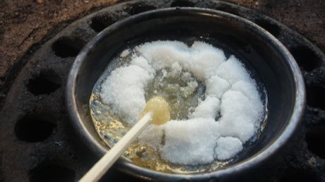

# Dalgona

*달고나 / 뽑기 · honeycomb candy carving*

**Encyclopedia ID 100** (permanent) · https://equalinformation.com/world-heritage-games-site/games/100-dalgona/

*Photo: 도자놀자, [CC BY 4.0](https://creativecommons.org/licenses/by/4.0/), [source on Wikimedia Commons](https://commons.wikimedia.org/wiki/File:Making_dalgona.jpg)*

Carefully trace and snap out a shape from a thin sugar disc with a needle, without cracking it.

## Heritage note

Part of the living heritage of South Korea. Animals are partners in this tradition; good care and local rules always come first.

## Origins

Usually placed in the era of Crossroads and Golden Ages (about 500 to 1500), although its exact origins are uncertain, within the cultural world of Japan and Korea.

## Facts

- **Where:** South Korea
- **Type:** Dexterity and skill games
- **Family:** Puzzle and dexterity toys
- **Era:** [Crossroads and Golden Ages](../../eras/crossroads/index.md) (uncertain)
- **Cradle:** [Japan and Korea](../../cradles/japan-korea/index.md)
- **Region:** East and Southeast Asia

## Related entries

- [Wayfinder](../../games/43-wayfinder/index.md)
- [Hangul syllable blocks](../../games/364-hangul-syllable-blocks/index.md)
- [Vai Syllabary Decoder](../../games/1394-vai-syllabary-decoder/index.md)
- [Goguryeo Mural Restoration](../../games/1454-goguryeo-mural-restoration/index.md)
- [Tuho](../../games/1089-tuho/index.md)
- [Kingyo-sukui](../../games/3-kingyo-sukui/index.md)

## Sources

- <https://commons.wikimedia.org/wiki/File:Making_dalgona.jpg>
