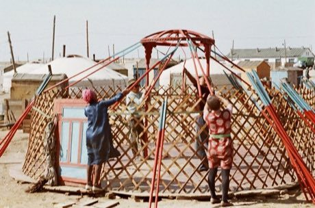

# Ger raising

*Also known as: гэр · Mongolian felt-tent build*

**Encyclopedia ID 101** (permanent) · https://bpupadhyaya.github.io/world-heritage-games-site/games/101-ger-raising/

*Photo: Vadas Robert (Vadaro), [CC BY-SA 3.0](https://creativecommons.org/licenses/by-sa/3.0/), [source on Wikimedia Commons](https://commons.wikimedia.org/wiki/File:Barun-Ger06.JPG)*

Assemble lattice walls, roof poles and crown ring in the correct order, then wrap felt and tie ropes before a weather timer ends.

## Heritage note

Part of the living heritage of Mongolia. Some forms of this practice carry deep meaning for the communities who keep it; here we describe the play and the craft only, with respect for its roots.

## Origins

Usually placed in the era of Modern Heritage (1800 to today), although its exact origins are uncertain, within the cultural world of Steppe and Arctic.

## Facts

- **Where:** Mongolia
- **Type:** Puzzles and mind games
- **Family:** Puzzle and dexterity toys
- **Era:** [Modern Heritage](../../eras/modern/index.md) (uncertain)
- **Cradle:** [Steppe and Arctic](../../cradles/steppe-arctic/index.md)
- **Region:** East and Southeast Asia

## Related entries

- [Alag Malkhii](../../games/941-alag-malkhii/index.md)
- [Kingyo-sukui](../../games/3-kingyo-sukui/index.md)
- [Stone Skipping](../../games/5-stone-skipping/index.md)
- [Disc-flip](../../games/8-disc-flip/index.md)
- [Sjoelen](../../games/9-sjoelen/index.md)
- [Shove ha'penny](../../games/54-shove-hapenny/index.md)

## Sources

- <https://commons.wikimedia.org/wiki/File:Barun-Ger06.JPG>
