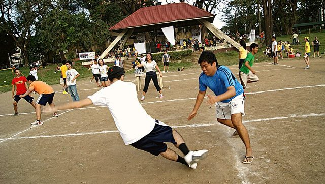

# Patintero

**Encyclopedia ID 1021** (permanent) · https://bpupadhyaya.github.io/world-heritage-games-site/games/1021-patintero/

*Photo: Yabang Pinoy, [CC BY 2.0](https://creativecommons.org/licenses/by/2.0/), [source on Wikimedia Commons](https://commons.wikimedia.org/wiki/File:Pinaka_Mahabang_Todo_Patintero_2012_(7732009648).jpg)*

Grid-crossing tag game widely played in streets.

## Heritage note

Part of the living heritage of Philippines.

## Origins

Usually placed in the era of Deep Past and First Games (before about 3000 BCE), although its exact origins are uncertain, within the cultural world of Southeast Asia and the Islands.

## Facts

- **Where:** Philippines
- **Type:** Street and playground games
- **Family:** Tag, chase and hide games
- **Era:** [Deep Past and First Games](../../eras/deep-past/index.md) (uncertain)
- **Cradle:** [Southeast Asia and the Islands](../../cradles/southeast-asia/index.md)
- **Region:** East and Southeast Asia
- **Players:** 6-10

## Related entries

- [Galah panjang](../../games/909-galah-panjang/index.md)
- [Tag](../../games/959-tag/index.md)
- [Hide and Seek](../../games/475-hide-and-seek/index.md)
- [Brännboll](../../games/1118-brannboll/index.md)
- [Ziziros](../../games/659-ziziros/index.md)
- [Fijian tag](../../games/712-fijian-tag/index.md)

## Sources

- <https://en.wikipedia.org/wiki/Traditional_games_in_the_Philippines>
