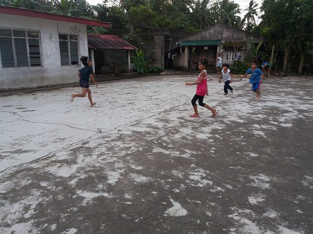

# Tumbang preso

**Encyclopedia ID 1028** (permanent) · https://bpupadhyaya.github.io/world-heritage-games-site/games/1028-tumbang-preso/

*Photo: Free2barredo, [CC BY-SA 4.0](https://creativecommons.org/licenses/by-sa/4.0/), [source on Wikimedia Commons](https://commons.wikimedia.org/wiki/File:Tumbang_Preso.jpg)*

Knock a tin can from its spot with slippers; guard tags runners.

## Heritage note

Part of the living heritage of Philippines.

## Origins

Usually placed in the era of Modern Heritage (1800 to today), although its exact origins are uncertain, within the cultural world of Southeast Asia and the Islands.

## Facts

- **Where:** Philippines
- **Type:** Street and playground games
- **Era:** [Modern Heritage](../../eras/modern/index.md) (uncertain)
- **Cradle:** [Southeast Asia and the Islands](../../cradles/southeast-asia/index.md)
- **Region:** East and Southeast Asia
- **Players:** 5+

## Play it

[Web preview](https://bpupadhyaya.github.io/games-site/games/tumbang-preso-can-toss/) · [Google Play](https://play.google.com/store/apps/details?id=com.equalinformation.arcforge.shell) · [App Store](https://apps.apple.com/us/app/arcforge-world-heritage-games/id6813746442)

## Related entries

- [Tinikling](../../games/141-tinikling/index.md)
- [Luksong tinik](../../games/146-luksong-tinik/index.md)
- [Sipa](../../games/1024-sipa/index.md)
- [Chinlone](../../games/16-chinlone/index.md)
- [Lato-lato](../../games/316-lato-lato/index.md)
- [Cublak-cublak suweng](../../games/325-cublak-cublak-suweng/index.md)

## Sources

- <https://en.wikipedia.org/wiki/Traditional_games_in_the_Philippines>
