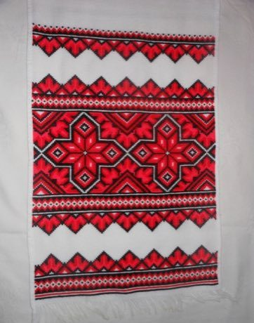

# Cross-Stitch Pattern Weaving

*Вишивка (vyshyvka)*

**Encyclopedia ID 103** (permanent) · https://equalinformation.com/world-heritage-games-site/games/103-cross-stitch-pattern-weaving/

*Photo: Харковець Марія, [CC BY-SA 4.0](https://creativecommons.org/licenses/by-sa/4.0/), [source on Wikimedia Commons](https://commons.wikimedia.org/wiki/File:Рушник_12.jpg)*

Fill a counted-thread grid stitch by stitch in red and black to reproduce diamond, star and zigzag borders on a linen cloth; solve charts of increasing size.

## Heritage note

Part of the living heritage of Ukraine. Some forms of this practice carry deep meaning for the communities who keep it; here we describe the play and the craft only, with respect for its roots.

## Origins

A living tradition passed from person to person; it is not tied to a single dated origin. It belongs to the cultural world of Northern and Eastern Europe.

## Facts

- **Where:** Ukraine
- **Type:** Crafts and making
- **Family:** Textile and weaving crafts
- **Era:** [Living Traditions](../../eras/living/index.md)
- **Cradle:** [Northern and Eastern Europe](../../cradles/north-east-europe/index.md)
- **Region:** Europe

## Related entries

- [Haapsalu lace shawl knitting](../../games/386-haapsalu-lace-shawl-knitting/index.md)
- [Belarusian straw weaving](../../games/387-belarusian-straw-weaving/index.md)
- [Hardanger embroidery](../../games/1296-hardanger-embroidery/index.md)
- [Lielvārde Sash Pattern Weaving](../../games/1327-lielvarde-sash-pattern-weaving/index.md)
- [Moldovan Woven Carpet Pattern Studio](../../games/1339-moldovan-woven-carpet-pattern-studio/index.md)
- [Pirot Kilim Weaver](../../games/1361-pirot-kilim-weaver/index.md)

## Sources

- <https://commons.wikimedia.org/wiki/File:Рушник_12.jpg>
