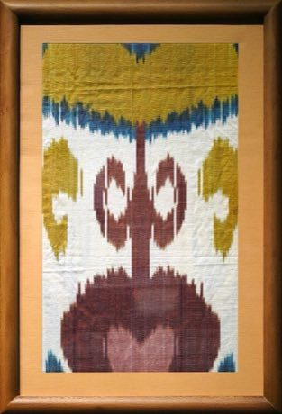

# Ikat Pattern Dyeing

*Also known as: Ikat · Abr*

**Encyclopedia ID 104** (permanent) · https://bpupadhyaya.github.io/world-heritage-games-site/games/104-ikat-pattern-dyeing/

*Photo: Panpanchik, [CC BY-SA 4.0](https://creativecommons.org/licenses/by-sa/4.0/), [source on Wikimedia Commons](https://commons.wikimedia.org/wiki/File:Adras_(Ikat)_ʼLanceʼ._1990s._Silk,_cotton.jpg)*

Bind and dye warp threads in blurred-edge patterns, then 'weave' to reveal a cloth whose feathered motifs only appear at the end; match target designs with the fewest dye steps.

## Heritage note

Part of the living heritage of Uzbekistan.

## Origins

A living tradition passed from person to person; it is not tied to a single dated origin. It belongs to the cultural world of Persia, Caucasus and Central Asia.

## Facts

- **Where:** Uzbekistan
- **Type:** Crafts and making
- **Family:** Textile and weaving crafts
- **Era:** [Living Traditions](../../eras/living/index.md)
- **Cradle:** [Persia, Caucasus and Central Asia](../../cradles/persia-central-asia/index.md)
- **Region:** South and Central Asia

## Related entries

- [Suzani embroidery](../../games/248-suzani-embroidery/index.md)
- [Persian Carpet Knotting](../../games/161-persian-carpet-knotting/index.md)
- [Turkmen gul carpet](../../games/249-turkmen-gul-carpet/index.md)
- [Kente strip weaving](../../games/22-kente-strip-weaving/index.md)
- [Celtic knot weave](../../games/25-celtic-knot-weave/index.md)
- [Sashiko Stitch Patterns](../../games/27-sashiko-stitch-patterns/index.md)

## Sources

- <https://commons.wikimedia.org/wiki/File:Adras_(Ikat)_ʼLanceʼ._1990s._Silk,_cotton.jpg>
