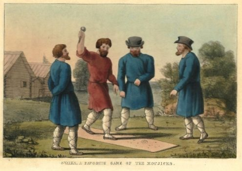

# Svaika

*Also known as: Свайка*

**Encyclopedia ID 1048** (permanent) · https://bpupadhyaya.github.io/world-heritage-games-site/games/1048-svaika/

*Photo: Unknown author Unknown author, [Public domain](https://creativecommons.org/publicdomain/mark/1.0/), [source on Wikimedia Commons](https://commons.wikimedia.org/wiki/File:Svaika.jpg)*

Throw a spike into a ring on the ground.

## Heritage note

Part of the living heritage of Russia.

## Origins

Usually placed in the era of Modern Heritage (1800 to today), although its exact origins are uncertain, within the cultural world of Northern and Eastern Europe.

## Facts

- **Where:** Russia
- **Type:** Street and playground games
- **Era:** [Modern Heritage](../../eras/modern/index.md) (uncertain)
- **Cradle:** [Northern and Eastern Europe](../../cradles/north-east-europe/index.md)
- **Region:** Europe
- **Players:** 2-6

## Related entries

- [Lapta](../../games/375-lapta/index.md)
- [Vanka-vstanka](../../games/9264-vanka-vstanka/index.md)
- [Kiiking](../../games/66-kiiking/index.md)
- [Nail driving](../../games/82-nail-driving/index.md)
- [Cymbergaj](../../games/377-cymbergaj/index.md)
- [Nohejbal](../../games/378-nohejbal/index.md)

## Sources

- <https://en.wikipedia.org/wiki/Svaika>
