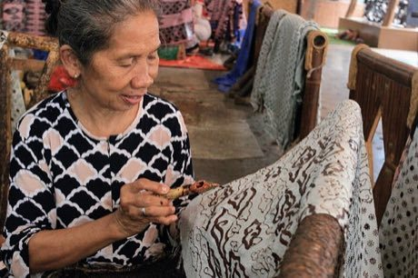

# Batik wax-resist pattern studio

*Batik tulis*

**Encyclopedia ID 105** (permanent) · https://equalinformation.com/world-heritage-games-site/games/105-batik-wax-resist-pattern-studio/

*Photo: Ahaetulla, [CC BY-SA 4.0](https://creativecommons.org/licenses/by-sa/4.0/), [source on Wikimedia Commons](https://commons.wikimedia.org/wiki/File:Batik_Artisan_Applying_Wax_with_Canting_in_Trusmi_Cirebon_Indonesia.jpg)*

Draw wax lines with a canting to protect areas, dip the cloth in dye baths from light to dark, then boil off the wax; plan resist layers to reveal a target pattern.

## Heritage note

Part of the living heritage of Indonesia, Malaysia.

## Origins

A living tradition passed from person to person; it is not tied to a single dated origin. It belongs to the cultural world of Southeast Asia and the Islands.

## Facts

- **Where:** Indonesia, Malaysia
- **Type:** Crafts and making
- **Family:** Textile and weaving crafts
- **Era:** [Living Traditions](../../eras/living/index.md)
- **Cradle:** [Southeast Asia and the Islands](../../cradles/southeast-asia/index.md)
- **Region:** East and Southeast Asia

## Related entries

- [Songket](../../games/320-songket/index.md)
- [Ketupat](../../games/322-ketupat/index.md)
- [Lao silk brocade weaving](../../games/311-lao-silk-brocade-weaving/index.md)
- [Tais](../../games/321-tais/index.md)
- [Banig mat weaving](../../games/1236-banig-mat-weaving/index.md)
- [Kente strip weaving](../../games/22-kente-strip-weaving/index.md)

## Sources

- <https://commons.wikimedia.org/wiki/File:Batik_Artisan_Applying_Wax_with_Canting_in_Trusmi_Cirebon_Indonesia.jpg>
