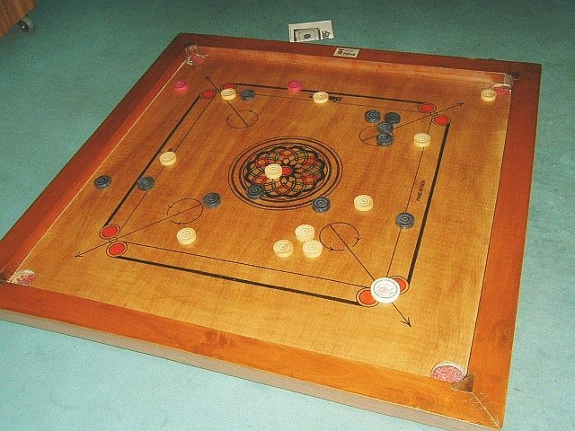

# Carrom

*Also known as: Karam*

**Encyclopedia ID 1059** (permanent) · https://bpupadhyaya.github.io/world-heritage-games-site/games/1059-carrom/

*Photo: Unknown author (public domain), [Public domain](https://creativecommons.org/publicdomain/mark/1.0/), [source on Wikimedia Commons](https://commons.wikimedia.org/wiki/File:Carrom.jpg)*

Players flick a weighted striker across a powdered board to sink wooden discs, and the red queen, into the four corner pockets.

## Heritage note

Part of the living heritage of Saudi Arabia, Oman, United Arab Emirates.

## Origins

Usually placed in the era of Crossroads and Golden Ages (about 500 to 1500), although its exact origins are uncertain, within the cultural world of Mesopotamia, Levant and Arabia.

## Facts

- **Where:** Saudi Arabia, Oman, United Arab Emirates, Qatar, Bahrain, Kuwait
- **Type:** Board and table games
- **Era:** [Crossroads and Golden Ages](../../eras/crossroads/index.md) (uncertain)
- **Cradle:** [Mesopotamia, Levant and Arabia](../../cradles/mesopotamia-levant/index.md)
- **Region:** Middle East and North Africa
- **Players:** 2-4

## Play it

[Web preview](https://bpupadhyaya.github.io/games-site/games/carrom-striker-and-queen/play/) · [Google Play](https://play.google.com/store/apps/details?id=com.equalinformation.arcforge.shell) · [App Store](https://apps.apple.com/us/app/arcforge-world-heritage-games/id6813746442)

## Related entries

- [Camel racing dash](../../games/19-camel-racing-dash/index.md)
- [Turkish Dama](../../games/155-turkish-dama/index.md)
- [Buzuq Long-Neck Lute](../../games/218-buzuq-long-neck-lute/index.md)
- [Saz / Bağlama](../../games/243-saz-baglama/index.md)
- [Rummikub](../../games/826-rummikub/index.md)
- [Edrees](../../games/1008-edrees/index.md)

## Sources

- <https://sandramajed.substack.com/p/world-of-arab-history-what-traditional>
- <https://marhaba.qa/traditional-qatari-games/>
- <https://kuwaittimes.com/ramadan-perfect-time-to-reminisce-about-traditional-kuwaiti-games/>
