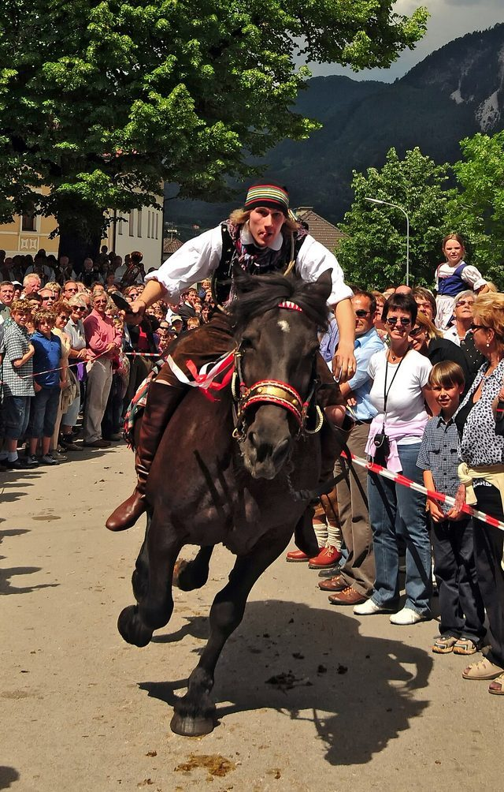

# Slovene quintain

*Also known as: Štehvanje*

**Encyclopedia ID 1073** (permanent) · https://bpupadhyaya.github.io/world-heritage-games-site/games/1073-slovene-quintain/

*Photo: Michael Gäbler, [CC BY 3.0](https://creativecommons.org/licenses/by/3.0/), [source on Wikimedia Commons](https://commons.wikimedia.org/wiki/File:Ritt_zum_Kufenstechen.jpg)*

Costumed riders on horseback strike a hanging barrel with bats in a village festival tournament.

## Heritage note

Part of the living heritage of Slovenia.

## Origins

Usually placed in the era of Classical Worlds (about 1000 BCE to 500 CE), although its exact origins are uncertain, within the cultural world of Mediterranean.

## Facts

- **Where:** Slovenia
- **Type:** Street and playground games
- **Family:** Horse and animal sports
- **Era:** [Classical Worlds](../../eras/classical/index.md) (uncertain)
- **Cradle:** [Mediterranean](../../cradles/mediterranean/index.md)
- **Region:** Europe
- **Players:** team

## Related entries

- [Cirit](../../games/156-cirit/index.md)
- [Pato](../../games/420-pato/index.md)
- [Champ de Mars turf](../../games/1253-champ-de-mars-turf/index.md)
- [Encang kuda](../../games/1067-encang-kuda/index.md)
- [Turkmen Akhal-Teke equestrian games](../../games/1170-turkmen-akhal-teke-equestrian-games/index.md)
- [Chavgon](../../games/1204-chavgon/index.md)

## Sources

- <https://en.wikipedia.org/wiki/Slovene_quintain>
