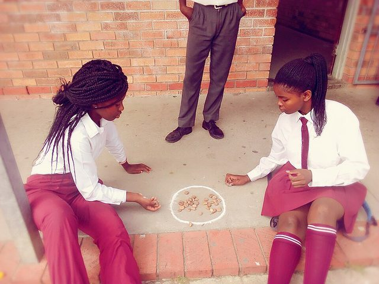

# Diketo

*Also known as: Magave · Upuca · Puca*

**Encyclopedia ID 1076** (permanent) · https://bpupadhyaya.github.io/world-heritage-games-site/games/1076-diketo/

*Photo: Kiowa17, [CC BY-SA 4.0](https://creativecommons.org/licenses/by-sa/4.0/), [source on Wikimedia Commons](https://commons.wikimedia.org/wiki/File:Puca!!.jpg)*

Toss a stone upward and sweep pebbles from a circle before catching it; jacks-style.

## Heritage note

Part of the living heritage of South Africa, Botswana, Lesotho.

## Origins

Usually placed in the era of Deep Past and First Games (before about 3000 BCE), although its exact origins are uncertain, within the cultural world of Africa: Southern Africa.

## Facts

- **Where:** South Africa, Botswana, Lesotho
- **Type:** Dexterity and skill games
- **Family:** Puzzle and dexterity toys
- **Era:** [Deep Past and First Games](../../eras/deep-past/index.md) (uncertain)
- **Cradle:** [Africa: Southern Africa](../../cradles/africa-south/index.md)
- **Region:** Sub-Saharan Africa
- **Players:** 2+

## Play it

[Try a 90-second preview in your browser](https://bpupadhyaya.github.io/games-site/games/diketo-stones/play/) · [Google Play](https://play.google.com/store/apps/details?id=com.equalinformation.arcforge.shell) · [App Store](https://apps.apple.com/us/app/arcforge-world-heritage-games/id6813746442)

## Related entries

- [Nhodo](../../games/1346-nhodo/index.md)
- [Street games](../../games/570-street-games/index.md)
- [Hopscotch](../../games/762-hopscotch/index.md)
- [Pebbles](../../games/874-pebbles/index.md)
- [Seed throwing](../../games/612-seed-throwing/index.md)
- [Seven-pebble toss game](../../games/620-seven-pebble-toss-game/index.md)

## Sources

- <https://en.wikipedia.org/wiki/Diketo_(game)>
- <https://www.dsac.gov.za/2023-Indigenous-Games-Festival>
- <https://dailynews.gov.bw/news-detail/24062>
- <https://lesotho.co.ls/2025/05/hrh-princess-senate-mohato-seeisos-shoeshoe-ea-moshoeshoe-initiative-continues-with-traditional-games-tour-at-pitseng-high-school/>
