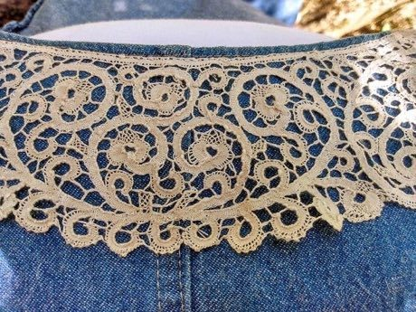

# Bobbin lace making

*Also known as: Kloppeln · dentelle aux fuseaux*

**Encyclopedia ID 108** (permanent) · https://bpupadhyaya.github.io/world-heritage-games-site/games/108-bobbin-lace-making/

*Photo: Mmangan333, [CC BY-SA 4.0](https://creativecommons.org/licenses/by-sa/4.0/), [source on Wikimedia Commons](https://commons.wikimedia.org/wiki/Cantu_bobbin_lace_collar.jpg)*

Cross and twist pairs of bobbins following a pricked pattern to weave a lace strip; the order of crossings is the puzzle.

## Heritage note

Part of the living heritage of Belgium.

## Origins

A living tradition passed from person to person; it is not tied to a single dated origin. It belongs to the cultural world of Celtic and Atlantic Europe.

## Facts

- **Where:** Belgium
- **Type:** Crafts and making
- **Family:** Textile and weaving crafts
- **Era:** [Living Traditions](../../eras/living/index.md)
- **Cradle:** [Celtic and Atlantic Europe](../../cradles/celtic-atlantic/index.md)
- **Region:** Europe

## Related entries

- [Celtic knot weave](../../games/25-celtic-knot-weave/index.md)
- [Nordic Colourwork Knitting](../../games/413-nordic-colourwork-knitting/index.md)
- [Ribbon Pole Weave](../../games/419-ribbon-pole-weave/index.md)
- [Tartan Sett Weaving](../../games/505-tartan-sett-weaving/index.md)
- [Kente strip weaving](../../games/22-kente-strip-weaving/index.md)
- [Sashiko Stitch Patterns](../../games/27-sashiko-stitch-patterns/index.md)

## Sources

- <https://commons.wikimedia.org/wiki/Cantu_bobbin_lace_collar.jpg>
