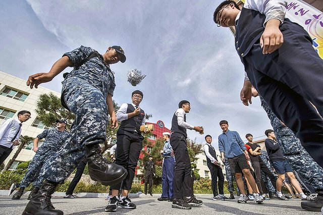

# Jegichagi

**Encyclopedia ID 1082** (permanent) · https://bpupadhyaya.github.io/world-heritage-games-site/games/1082-jegichagi/

*Photo: Official U.S. Navy Page from United States of America MC2 Andrew Schneider/U.S. Navy, [Public domain](https://creativecommons.org/publicdomain/mark/1.0/), [source on Wikimedia Commons](https://commons.wikimedia.org/wiki/File:Sailors_play_Jegichagi_with_Korean_students_during_a_community_relations_event_(30361247131).jpg)*

Players kick a paper-and-coin shuttle (jegi) and count how many kicks they can make without letting it fall.

## Heritage note

Part of the living heritage of South Korea, North Korea.

## Origins

Usually placed in the era of Modern Heritage (1800 to today), although its exact origins are uncertain, within the cultural world of Japan and Korea.

## Facts

- **Where:** South Korea, North Korea
- **Type:** Street and playground games
- **Era:** [Modern Heritage](../../eras/modern/index.md) (uncertain)
- **Cradle:** [Japan and Korea](../../cradles/japan-korea/index.md)
- **Region:** East and Southeast Asia
- **Players:** 1+

## Related entries

- [Neolttwigi](../../games/4-neolttwigi/index.md)
- [Hangul syllable blocks](../../games/364-hangul-syllable-blocks/index.md)
- [Tuho](../../games/1089-tuho/index.md)
- [Haenyeo Breath Dive](../../games/1459-haenyeo-breath-dive/index.md)
- [Kingyo-sukui](../../games/3-kingyo-sukui/index.md)
- [Daruma Otoshi](../../games/63-daruma-otoshi/index.md)

## Sources

- <https://en.wikipedia.org/wiki/Jegichagi>
