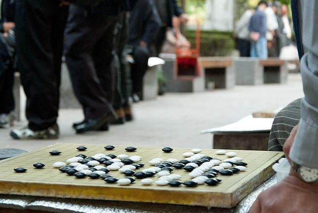

# Baduk

*Also known as: Go*

**Encyclopedia ID 1084** (permanent) · https://bpupadhyaya.github.io/world-heritage-games-site/games/1084-baduk/

*Photo: theaucitron, [CC BY-SA 2.0](https://creativecommons.org/licenses/by-sa/2.0/), [source on Wikimedia Commons](https://commons.wikimedia.org/wiki/File:Baduk_or_Go.jpg)*

The Korean name for go; the Korea Baduk Association runs the professional system and tournaments.

## Heritage note

Part of the living heritage of South Korea.

## Origins

Usually placed in the era of Classical Worlds (about 1000 BCE to 500 CE), although its exact origins are uncertain, within the cultural world of Japan and Korea.

## Facts

- **Where:** South Korea
- **Type:** Board and table games
- **Family:** Go family
- **Era:** [Classical Worlds](../../eras/classical/index.md) (uncertain)
- **Cradle:** [Japan and Korea](../../cradles/japan-korea/index.md)
- **Region:** East and Southeast Asia
- **Players:** 2

## Play it

[About the game](https://bpupadhyaya.github.io/games-site/games/go-stones-and-territory/) · [Google Play](https://play.google.com/store/apps/details?id=com.equalinformation.arcforge.shell) · [App Store](https://apps.apple.com/us/app/arcforge-world-heritage-games/id6813746442)

## Related entries

- [Go](../../games/634-go/index.md)
- [Gayageum](../../games/361-gayageum/index.md)
- [Geomungo](../../games/1453-geomungo/index.md)
- [Omok](../../games/1088-omok/index.md)
- [Shakuhachi](../../games/349-shakuhachi/index.md)
- [Paduk](../../games/990-paduk/index.md)

## Sources

- <https://en.wikipedia.org/wiki/Korea_Baduk_Association>
- <http://english.baduk.or.kr/sub02_01.htm?menu=f12>
