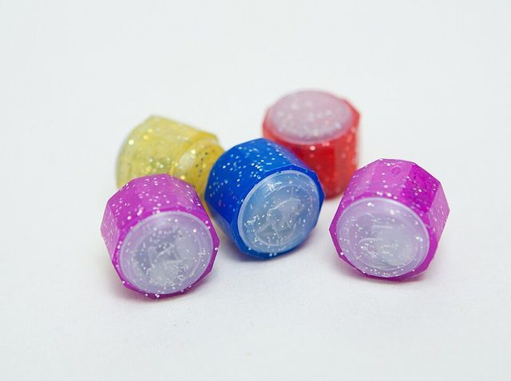

# Gonggi

*Also known as: Gonggi nori · Five stones*

**Encyclopedia ID 1085** (permanent) · https://bpupadhyaya.github.io/world-heritage-games-site/games/1085-gonggi/

*Photo: 국립국어원, CC BY-SA 2.0 kr, [source on Wikimedia Commons](https://commons.wikimedia.org/wiki/File:Gonggi_pebbles.jpg)*

Gonggi is a dexterity and skill game tradition from South Korea.

## Heritage note

Part of the living heritage of South Korea.

## Origins

Usually placed in the era of Deep Past and First Games (before about 3000 BCE), although its exact origins are uncertain, within the cultural world of Japan and Korea.

## Facts

- **Where:** South Korea
- **Type:** Dexterity and skill games
- **Family:** Dice and knucklebone games
- **Era:** [Deep Past and First Games](../../eras/deep-past/index.md) (uncertain)
- **Cradle:** [Japan and Korea](../../cradles/japan-korea/index.md)
- **Region:** East and Southeast Asia
- **Players:** 1-4

## Play it

[Web preview](https://bpupadhyaya.github.io/games-site/games/gonggi-five-stones/) · [Google Play](https://play.google.com/store/apps/details?id=com.equalinformation.arcforge.shell) · [App Store](https://apps.apple.com/us/app/arcforge-world-heritage-games/id6813746442)

## Related entries

- [Knucklebone game](../../games/522-knucklebone-game/index.md)
- [Taba](../../games/594-taba/index.md)
- [Jacks](../../games/697-jacks/index.md)
- [Jacks, Dandy Shandy, ring games](../../games/842-jacks-dandy-shandy-ring-games/index.md)
- [Besh Tash](../../games/869-besh-tash/index.md)
- [Five stones](../../games/907-five-stones/index.md)

## Sources

- <https://en.wikipedia.org/wiki/Gonggi>
