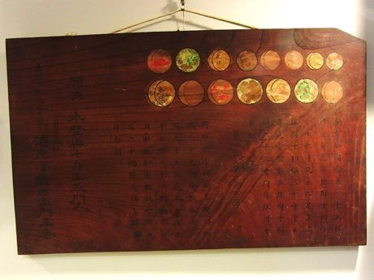

# Sangaku Geometry Puzzles

*Also known as: 算額*

**Encyclopedia ID 109** (permanent) · https://bpupadhyaya.github.io/world-heritage-games-site/games/109-sangaku-geometry-puzzles/

*Photo: Momotarou2012, [CC BY-SA 3.0](https://creativecommons.org/licenses/by-sa/3.0/), [source on Wikimedia Commons](https://commons.wikimedia.org/wiki/File:Sangaku_of_Konnoh_Hachimangu_1850.jpg)*

Elegant circle-and-polygon problems from Edo-era tablets: place, resize or measure shapes so tangent circles and areas match a target.

## Heritage note

Part of the living heritage of Japan. Some forms of this practice carry deep meaning for the communities who keep it; here we describe the play and the craft only, with respect for its roots.

## Origins

Usually placed in the era of Age of Contact and Craft (about 1500 to 1800), although its exact origins are uncertain, within the cultural world of Japan and Korea.

## Facts

- **Where:** Japan
- **Type:** Puzzles and mind games
- **Family:** Puzzle and dexterity toys
- **Era:** [Age of Contact and Craft](../../eras/contact/index.md) (uncertain)
- **Cradle:** [Japan and Korea](../../cradles/japan-korea/index.md)
- **Region:** East and Southeast Asia

## Related entries

- [Fukuwarai](../../games/94-fukuwarai/index.md)
- [Kingyo-sukui](../../games/3-kingyo-sukui/index.md)
- [Secret Puzzle Box](../../games/29-secret-puzzle-box/index.md)
- [Charro lasso roping](../../games/60-charro-lasso-roping/index.md)
- [Daruma Otoshi](../../games/63-daruma-otoshi/index.md)
- [Lo Shu Magic Square](../../games/111-lo-shu-magic-square/index.md)

## Sources

- <https://commons.wikimedia.org/wiki/File:Sangaku_of_Konnoh_Hachimangu_1850.jpg>
