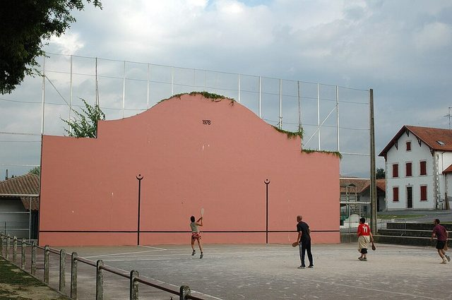

# Basque Pelota

*Also known as: Pelota Vasca*

**Encyclopedia ID 1094** (permanent) · https://bpupadhyaya.github.io/world-heritage-games-site/games/1094-basque-pelota/

*Photo: No machine-readable author provided. Harrieta171 assumed (based on copyright claims)., [CC BY 2.5](https://creativecommons.org/licenses/by/2.5/), [source on Wikimedia Commons](https://commons.wikimedia.org/wiki/File:Ustaritz_Fronton_Pala.jpg)*

Wall-and-court ball sport played with the hand, racket or basket; frontón courts in most Basque towns.

## Heritage note

Part of the living heritage of Spain, France.

## Origins

Usually placed in the era of Modern Heritage (1800 to today), although its exact origins are uncertain, within the cultural world of Mediterranean.

## Facts

- **Where:** Spain, France
- **Type:** Street and playground games
- **Era:** [Modern Heritage](../../eras/modern/index.md) (uncertain)
- **Cradle:** [Mediterranean](../../cradles/mediterranean/index.md)
- **Region:** Europe
- **Players:** 2-4

## Play it

[Web preview](https://bpupadhyaya.github.io/games-site/games/pelota-wall-rally/play/) · [Google Play](https://play.google.com/store/apps/details?id=com.equalinformation.arcforge.shell) · [App Store](https://apps.apple.com/us/app/arcforge-world-heritage-games/id6813746442)

## Related entries

- [Castells](../../games/119-castells/index.md)
- [Portolan Chart Navigator](../../games/503-portolan-chart-navigator/index.md)
- [Ring Tilting](../../games/65-ring-tilting/index.md)
- [Flag Tossing](../../games/395-flag-tossing/index.md)
- [Euclid's Ruler and Compass](../../games/396-euclids-ruler-and-compass/index.md)
- [Antikythera Gear Train](../../games/397-antikythera-gear-train/index.md)
