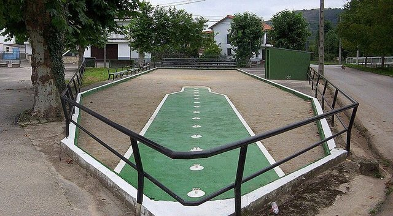

# Cantabrian palm bowling

*Also known as: Bolo palma*

**Encyclopedia ID 1096** (permanent) · https://bpupadhyaya.github.io/world-heritage-games-site/games/1096-cantabrian-palm-bowling/

*Photo: Emilio Gómez Fernández, [CC BY 2.5](https://creativecommons.org/licenses/by/2.5/), [source on Wikimedia Commons](https://commons.wikimedia.org/wiki/File:Bolera_de_La_Helguera_-_Barrio_de_Arriba.jpg)*

Cantabrian bowling where a wooden ball is thrown at nine pins; deeply local with 16th-century records.

## Heritage note

Part of the living heritage of Spain.

## Origins

Usually placed in the era of Age of Contact and Craft (about 1500 to 1800), although its exact origins are uncertain, within the cultural world of Mediterranean.

## Facts

- **Where:** Spain
- **Type:** Street and playground games
- **Era:** [Age of Contact and Craft](../../eras/contact/index.md) (uncertain)
- **Cradle:** [Mediterranean](../../cradles/mediterranean/index.md)
- **Region:** Europe
- **Players:** 2+

## Related entries

- [Venetian lagoon regatta](../../games/486-venetian-lagoon-regatta/index.md)
- [Tombola](../../games/829-tombola/index.md)
- [Scopa](../../games/832-scopa/index.md)
- [Maghrebi 5x5 capture game](../../games/887-maghrebi-5x5-capture-game/index.md)
- [Remi](../../games/993-remi/index.md)
- [Castells](../../games/119-castells/index.md)

## Sources

- <https://en.wikipedia.org/wiki/Bolo_palma>
