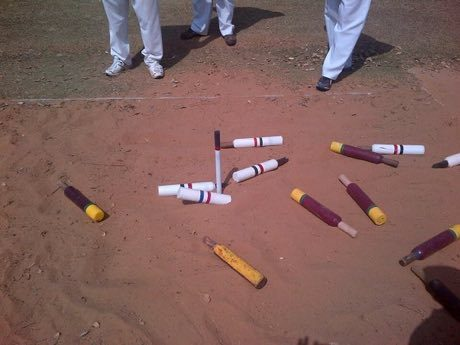

# Jukskei

*Also known as: Jukskei (Afrikaans)*

**Encyclopedia ID 11** (permanent) · https://bpupadhyaya.github.io/world-heritage-games-site/games/11-jukskei/

*Photo: Francois1012 (User), [CC BY-SA 3.0](https://creativecommons.org/licenses/by-sa/3.0/), [source on Wikimedia Commons](https://commons.wikimedia.org/wiki/File:A_classic_jukskei_game_2014-02-01_12-20.jpg)*

Throw a flat-sided wooden pin to land it against or knock a stake at the far end of a sand pitch, scoring points per throw over rounds.

## Heritage note

Part of the living heritage of South Africa.

## Origins

Usually placed in the era of Modern Heritage (1800 to today), although its exact origins are uncertain, within the cultural world of Africa: Southern Africa.

## Facts

- **Where:** South Africa
- **Type:** Archery, throwing and target games
- **Family:** Archery and target games
- **Era:** [Modern Heritage](../../eras/modern/index.md) (uncertain)
- **Cradle:** [Africa: Southern Africa](../../cradles/africa-south/index.md)
- **Region:** Sub-Saharan Africa

## Play it

[Try a 90-second preview in your browser](https://bpupadhyaya.github.io/games-site/games/jukskei/play/) · [Google Play](https://play.google.com/store/apps/details?id=com.equalinformation.arcforge.shell) · [App Store](https://apps.apple.com/us/app/arcforge-world-heritage-games/id6813746442)

## Related entries

- [Pitch-pot](../../games/2-pitch-pot/index.md)
- [Lagori](../../games/14-lagori/index.md)
- [Tejo](../../games/57-tejo/index.md)
- [Bocce](../../games/830-bocce/index.md)
- [Kubb](../../games/1120-kubb/index.md)
- [Chilean Rayuela](../../games/1427-chilean-rayuela/index.md)

## Sources

- <https://commons.wikimedia.org/wiki/File:A_classic_jukskei_game_2014-02-01_12-20.jpg>
