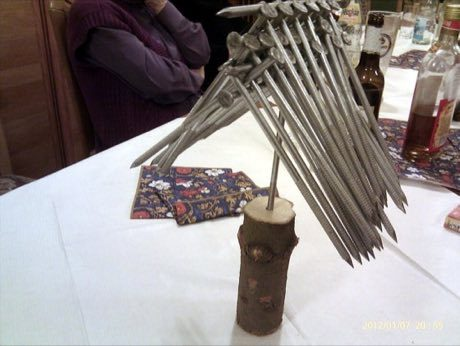

# Tavern Nail and Wire Puzzles

*Also known as: Wirrwarr · Nagelspiele*

**Encyclopedia ID 110** (permanent) · https://bpupadhyaya.github.io/world-heritage-games-site/games/110-tavern-nail-and-wire-puzzles/

*Photo: Merkel, [CC BY-SA 3.0](https://creativecommons.org/licenses/by-sa/3.0/), [source on Wikimedia Commons](https://commons.wikimedia.org/wiki/File:50naegel-nagelprobe-magicnails-berchtesgadener.jpg)*

Untangle iron rings off a horseshoe or loop, or balance a dozen nails on one nail head (the nail balancing challenge) by sliding or hooking parts.

## Heritage note

Part of the living heritage of Germany, United Kingdom.

## Origins

Usually placed in the era of Classical Worlds (about 1000 BCE to 500 CE), although its exact origins are uncertain, within the cultural world of Northern and Eastern Europe.

## Facts

- **Where:** Germany, United Kingdom
- **Type:** Puzzles and mind games
- **Family:** Puzzle and dexterity toys
- **Era:** [Classical Worlds](../../eras/classical/index.md) (uncertain)
- **Cradle:** [Northern and Eastern Europe](../../cradles/north-east-europe/index.md)
- **Region:** Europe

## Play it

[Web preview](https://bpupadhyaya.github.io/) · [Google Play](https://play.google.com/store/apps/details?id=com.equalinformation.arcforge.shell) · [App Store](https://apps.apple.com/us/app/arcforge-world-heritage-games/id6813746442)

## Related entries

- [Egrang](../../games/17-egrang/index.md)
- [Nail driving](../../games/82-nail-driving/index.md)
- [Clockwork Movement Builder](../../games/502-clockwork-movement-builder/index.md)
- [Dougong Bracket Stacking](../../games/504-dougong-bracket-stacking/index.md)
- [Kiiking](../../games/66-kiiking/index.md)
- [Ringridning](../../games/1365-ringridning/index.md)

## Sources

- <https://commons.wikimedia.org/wiki/File:50naegel-nagelprobe-magicnails-berchtesgadener.jpg>
