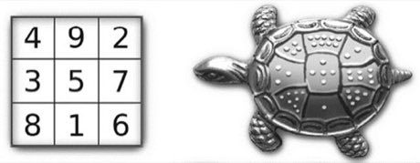

# Lo Shu Magic Square

*Also known as: 洛书*

**Encyclopedia ID 111** (permanent) · https://bpupadhyaya.github.io/world-heritage-games-site/games/111-lo-shu-magic-square/

*Photo: Неизвестен, [CC0](https://creativecommons.org/publicdomain/zero/1.0/), [source on Wikimedia Commons](https://commons.wikimedia.org/wiki/File:Lo_Shu_square.jpg)*

Place the numbers 1 to 9 on a 3x3 grid so every row, column and diagonal sums to 15, then climb to larger sizes and variants.

## Heritage note

Part of the living heritage of China.

## Origins

Usually placed in the era of Age of Contact and Craft (about 1500 to 1800), although its exact origins are uncertain, within the cultural world of China.

## Facts

- **Where:** China
- **Type:** Puzzles and mind games
- **Family:** Puzzle and dexterity toys
- **Era:** [Age of Contact and Craft](../../eras/contact/index.md) (uncertain)
- **Cradle:** [China](../../cradles/china/index.md)
- **Region:** East and Southeast Asia

## Related entries

- [Stone Arch Bridge Builder](../../games/495-stone-arch-bridge-builder/index.md)
- [Charro lasso roping](../../games/60-charro-lasso-roping/index.md)
- [Fukuwarai](../../games/94-fukuwarai/index.md)
- [Luban lock](../../games/99-luban-lock/index.md)
- [Sangaku Geometry Puzzles](../../games/109-sangaku-geometry-puzzles/index.md)
- [Intha leg rowing on the lake](../../games/304-intha-leg-rowing-on-the-lake/index.md)

## Sources

- <https://commons.wikimedia.org/wiki/File:Lo_Shu_square.jpg>
