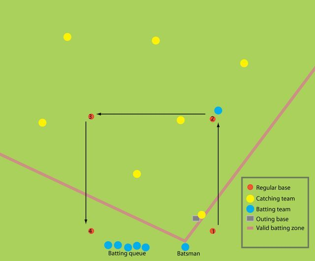

# Brännboll

*Also known as: burnball*

**Encyclopedia ID 1118** (permanent) · https://bpupadhyaya.github.io/world-heritage-games-site/games/1118-brannboll/

*Photo: EditorInTheRye, [CC BY-SA 3.0](https://creativecommons.org/licenses/by-sa/3.0/), [source on Wikimedia Commons](https://commons.wikimedia.org/wiki/File:Brannboll.png)*

A bat-and-ball game where batters run around four bases and fielders tag or catch them.

## Heritage note

Part of the living heritage of Sweden.

## Origins

Usually placed in the era of Deep Past and First Games (before about 3000 BCE), although its exact origins are uncertain, within the cultural world of Northern and Eastern Europe.

## Facts

- **Where:** Sweden
- **Type:** Street and playground games
- **Family:** Tag, chase and hide games
- **Era:** [Deep Past and First Games](../../eras/deep-past/index.md) (uncertain)
- **Cradle:** [Northern and Eastern Europe](../../cradles/north-east-europe/index.md)
- **Region:** Europe
- **Players:** 8-24

## Related entries

- [Palant](../../games/1031-palant/index.md)
- [Hide and Seek](../../games/475-hide-and-seek/index.md)
- [Galah panjang](../../games/909-galah-panjang/index.md)
- [Tag](../../games/959-tag/index.md)
- [Patintero](../../games/1021-patintero/index.md)
- [Ziziros](../../games/659-ziziros/index.md)

## Sources

- <https://en.wikipedia.org/wiki/Br%C3%A4nnboll>
- <https://en.wikipedia.org/wiki/Br%C3%A4nnbollscupen>
