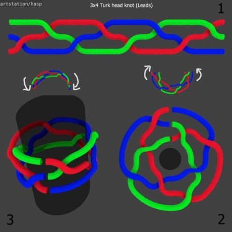

# Sailor's Knotwork and Turk's Head

*Also known as: Knots at sea*

**Encyclopedia ID 112** (permanent) · https://bpupadhyaya.github.io/world-heritage-games-site/games/112-sailors-knotwork-and-turks-head/

*Photo: Zaripov999, [CC BY-SA 4.0](https://creativecommons.org/licenses/by-sa/4.0/), [source on Wikimedia Commons](https://commons.wikimedia.org/wiki/File:3x4_turk_head_knot.jpg)*

Follow the lead around a cylinder to weave a decorative Turk's head or lanyard braid by dragging rope over and under strands.

## Heritage note

A tradition shared by communities in many places.

## Origins

A living tradition passed from person to person; it is not tied to a single dated origin.

## Facts

- **Where:** Shared across many places
- **Type:** Crafts and making
- **Family:** Paper, ink and painting crafts
- **Era:** [Living Traditions](../../eras/living/index.md)
- **Cradle:** [Shared across the world](../../cradles/worldwide/index.md)
- **Region:** Europe

## Related entries

- [Ebru paper marbling](../../games/20-ebru-paper-marbling/index.md)
- [Ndebele geometric wall painting](../../games/23-ndebele-geometric-wall-painting/index.md)
- [Chinese knotting](../../games/26-chinese-knotting/index.md)
- [Matryoshka](../../games/28-matryoshka/index.md)
- [Bogolan mud cloth](../../games/86-bogolan-mud-cloth/index.md)
- [Zulu beadwork letters](../../games/88-zulu-beadwork-letters/index.md)

## Sources

- <https://commons.wikimedia.org/wiki/File:3x4_turk_head_knot.jpg>
