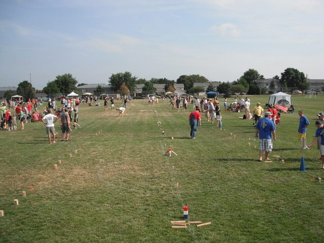

# Kubb

**Encyclopedia ID 1120** (permanent) · https://bpupadhyaya.github.io/world-heritage-games-site/games/1120-kubb/

*Photo: Joshfeathers, [CC BY-SA 3.0](https://creativecommons.org/licenses/by-sa/3.0/), [source on Wikimedia Commons](https://commons.wikimedia.org/wiki/File:US_National_Kubb_Championship.jpg)*

Teams throw batons at wooden blocks across a pitch and finish by toppling the king.

## Heritage note

Part of the living heritage of Sweden.

## Origins

Usually placed in the era of Modern Heritage (1800 to today), although its exact origins are uncertain, within the cultural world of Northern and Eastern Europe.

## Facts

- **Where:** Sweden
- **Type:** Street and playground games
- **Family:** Archery and target games
- **Era:** [Modern Heritage](../../eras/modern/index.md) (uncertain)
- **Cradle:** [Northern and Eastern Europe](../../cradles/north-east-europe/index.md)
- **Region:** Europe
- **Players:** 2-12

## Play it

[Web preview](https://bpupadhyaya.github.io/games-site/games/kubb-toss/play/) · [Google Play](https://play.google.com/store/apps/details?id=com.equalinformation.arcforge.shell) · [App Store](https://apps.apple.com/us/app/arcforge-world-heritage-games/id6813746442)

## Related entries

- [Pitch-pot](../../games/2-pitch-pot/index.md)
- [Jukskei](../../games/11-jukskei/index.md)
- [Lagori](../../games/14-lagori/index.md)
- [Tejo](../../games/57-tejo/index.md)
- [Bocce](../../games/830-bocce/index.md)
- [Chilean Rayuela](../../games/1427-chilean-rayuela/index.md)

## Sources

- <https://en.wikipedia.org/wiki/Kubb>
- <https://www.kubb.world/the-game>
