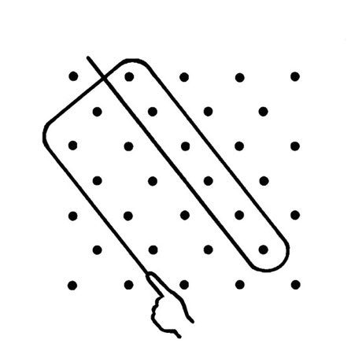

# Lusona Sand Drawings

*Also known as: Sona · lusona*

**Encyclopedia ID 113** (permanent) · https://bpupadhyaya.github.io/world-heritage-games-site/games/113-lusona-sand-drawings/

*Photo: Unknown authorUnknown author, [Public domain](https://creativecommons.org/publicdomain/mark/1.0/), [source on Wikimedia Commons](https://commons.wikimedia.org/wiki/File:Lusona_1.jpg)*

Trace one continuous line around a grid of dots without lifting your finger or retracing, so the line encloses every dot and returns to start.

## Heritage note

Part of the living heritage of Angola, Zambia, DR Congo.

## Origins

Usually placed in the era of Modern Heritage (1800 to today), although its exact origins are uncertain, within the cultural world of Africa: Southern Africa.

## Facts

- **Where:** Angola, Zambia, DR Congo
- **Type:** Puzzles and mind games
- **Family:** Puzzle and dexterity toys
- **Era:** [Modern Heritage](../../eras/modern/index.md) (uncertain)
- **Cradle:** [Africa: Southern Africa](../../cradles/africa-south/index.md)
- **Region:** Sub-Saharan Africa

## Related entries

- [Kingyo-sukui](../../games/3-kingyo-sukui/index.md)
- [Stone Skipping](../../games/5-stone-skipping/index.md)
- [Disc-flip](../../games/8-disc-flip/index.md)
- [Sjoelen](../../games/9-sjoelen/index.md)
- [Shove ha'penny](../../games/54-shove-hapenny/index.md)
- [Limbo](../../games/58-limbo/index.md)

## Sources

- <https://commons.wikimedia.org/wiki/File:Lusona_1.jpg>
