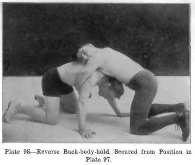

# Gushtingiri wrestling

*Also known as: Gushtingiri*

**Encyclopedia ID 1133** (permanent) · https://bpupadhyaya.github.io/world-heritage-games-site/games/1133-gushtingiri-wrestling/

*Photo: Martin Burns and the Farmer Burns School of Wrestling; scans by Gordon Anderson, [Public domain](https://creativecommons.org/publicdomain/mark/1.0/), [source on Wikimedia Commons](https://commons.wikimedia.org/wiki/File:Burns03-05-70-sprawl.jpg)*

Robe and belt wrestling where first throw to the back wins.

## Heritage note

Part of the living heritage of Tajikistan.

## Origins

Usually placed in the era of River Valleys and First Cities (about 3000 to 1000 BCE), although its exact origins are uncertain, within the cultural world of Persia, Caucasus and Central Asia.

## Facts

- **Where:** Tajikistan
- **Type:** Street and playground games
- **Family:** Wrestling
- **Era:** [River Valleys and First Cities](../../eras/river-valleys/index.md) (uncertain)
- **Cradle:** [Persia, Caucasus and Central Asia](../../cradles/persia-central-asia/index.md)
- **Region:** South and Central Asia
- **Players:** 2

## Related entries

- [Kurash](../../games/253-kurash/index.md)
- [Chidaoba](../../games/734-chidaoba/index.md)
- [Kokh](../../games/1317-kokh/index.md)
- [Laamb Wrestling Bout](../../games/166-laamb-wrestling-bout/index.md)
- [Kushti / Pehlwani mud wrestling](../../games/256-kushti-pehlwani-mud-wrestling/index.md)
- [Sumo bout](../../games/359-sumo-bout/index.md)

## Sources

- <https://eurasia.travel/tajikistan/culture/games/>
- <https://en.wikipedia.org/wiki/Buzkashi>
