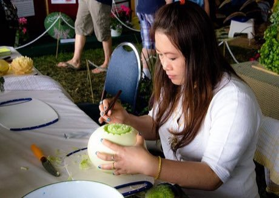

# Thai fruit and vegetable carving

*Also known as: Kae sa lak*

**Encyclopedia ID 114** (permanent) · https://bpupadhyaya.github.io/world-heritage-games-site/games/114-thai-fruit-and-vegetable-carving/

*Photo: Kurt Bauschardt, [CC BY-SA 2.0](https://creativecommons.org/licenses/by-sa/2.0/), [source on Wikimedia Commons](https://commons.wikimedia.org/wiki/File:Fruit_Carving_(9453184585).jpg)*

Trace petal cuts with a small knife on a melon or gourd, layering curved cuts from the centre outward to bloom a flower within a limit of mistakes.

## Heritage note

Part of the living heritage of Thailand. Some forms of this practice carry deep meaning for the communities who keep it; here we describe the play and the craft only, with respect for its roots. It is presented as sport and skill, never as real fighting.

## Origins

A living tradition passed from person to person; it is not tied to a single dated origin. It belongs to the cultural world of Southeast Asia and the Islands.

## Facts

- **Where:** Thailand
- **Type:** Crafts and making
- **Family:** Pottery, wood and metal crafts
- **Era:** [Living Traditions](../../eras/living/index.md)
- **Cradle:** [Southeast Asia and the Islands](../../cradles/southeast-asia/index.md)
- **Region:** East and Southeast Asia

## Related entries

- [Burmese lacquerware engraving](../../games/310-burmese-lacquerware-engraving/index.md)
- [Shophouse facade builder](../../games/1373-shophouse-facade-builder/index.md)
- [Gender](../../games/18923-gender/index.md)
- [Zellij tile mosaic](../../games/21-zellij-tile-mosaic/index.md)
- [Glassblowing](../../games/121-glassblowing/index.md)
- [Azulejo tile painting](../../games/122-azulejo-tile-painting/index.md)

## Sources

- <https://commons.wikimedia.org/wiki/File:Fruit_Carving_(9453184585).jpg>
