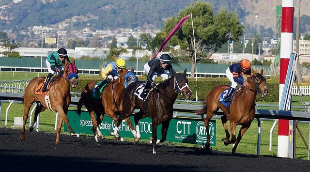

# Regional pony race meets

*Also known as: Horse racing (Timor pony meets)*

**Encyclopedia ID 1145** (permanent) · https://bpupadhyaya.github.io/world-heritage-games-site/games/1145-regional-pony-race-meets/

*Photo: Noah Salzman, [CC BY-SA 4.0](https://creativecommons.org/licenses/by-sa/4.0/), [source on Wikimedia Commons](https://commons.wikimedia.org/wiki/File:GGF_Race5.jpg)*

Regional race meets run on the small, agile Timor pony; the only traditional pastime Wikipedia names for the country.

## Heritage note

Part of the living heritage of Timor-Leste.

## Origins

Usually placed in the era of Modern Heritage (1800 to today), although its exact origins are uncertain, within the cultural world of Southeast Asia and the Islands.

## Facts

- **Where:** Timor-Leste
- **Type:** Street and playground games
- **Era:** [Modern Heritage](../../eras/modern/index.md) (uncertain)
- **Cradle:** [Southeast Asia and the Islands](../../cradles/southeast-asia/index.md)
- **Region:** East and Southeast Asia
- **Players:** riders

## Related entries

- [Chinlone](../../games/16-chinlone/index.md)
- [Tinikling](../../games/141-tinikling/index.md)
- [Luksong tinik](../../games/146-luksong-tinik/index.md)
- [Lato-lato](../../games/316-lato-lato/index.md)
- [Cublak-cublak suweng](../../games/325-cublak-cublak-suweng/index.md)
- [Silat Melayu](../../games/605-silat-melayu/index.md)

## Sources

- <https://en.wikipedia.org/wiki/Culture_of_Timor-Leste>
