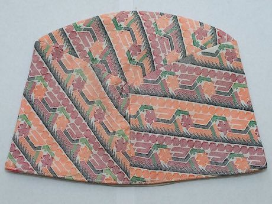

# Dhaka weave pattern loom

*ढाका*

**Encyclopedia ID 115** (permanent) · https://bpupadhyaya.github.io/world-heritage-games-site/games/115-dhaka-weave-pattern-loom/

*Photo: Masuriya-Hem chand, [CC BY-SA 4.0](https://creativecommons.org/licenses/by-sa/4.0/), [source on Wikimedia Commons](https://commons.wikimedia.org/wiki/File:Dhaka_topi_nepal's.jpg)*

Fill a loom grid by choosing weft thread colours to reproduce geometric Dhaka bands row by row, then see the finished cloth become a cap or shawl.

## Heritage note

Part of the living heritage of Nepal.

## Origins

A living tradition passed from person to person; it is not tied to a single dated origin. It belongs to the cultural world of South Asia.

## Facts

- **Where:** Nepal
- **Type:** Crafts and making
- **Family:** Textile and weaving crafts
- **Era:** [Living Traditions](../../eras/living/index.md)
- **Cradle:** [South Asia](../../cradles/south-asia/index.md)
- **Region:** South and Central Asia

## Related entries

- [Allo nettle fibre weaving](../../games/1228-allo-nettle-fibre-weaving/index.md)
- [Phulkari darn-stitch embroidery](../../games/257-phulkari-darn-stitch-embroidery/index.md)
- [Bandhani tie-dye](../../games/258-bandhani-tie-dye/index.md)
- [Kantha running-stitch quilt](../../games/284-kantha-running-stitch-quilt/index.md)
- [Nakshi Kantha embroidery](../../games/294-nakshi-kantha-embroidery/index.md)
- [Sri Lankan batik wax-resist painting](../../games/1239-sri-lankan-batik-wax-resist-painting/index.md)

## Sources

- <https://commons.wikimedia.org/wiki/File:Dhaka_topi_nepal's.jpg>
