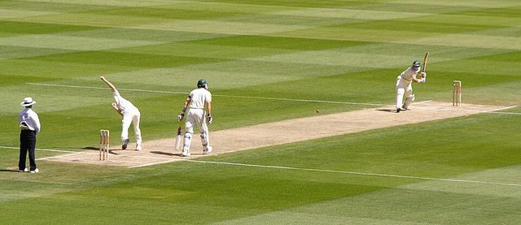

# Yard cricket

*Also known as: Cricket (street · yard)*

**Encyclopedia ID 1151** (permanent) · https://bpupadhyaya.github.io/world-heritage-games-site/games/1151-yard-cricket/

*Photo: Prescott Pym on Flickr, [CC BY 2.0](https://creativecommons.org/licenses/by/2.0/), [source on Wikimedia Commons](https://commons.wikimedia.org/wiki/File:Pollock_to_Hussey.jpg)*

Improvised backyard cricket with a homemade bat and ball.

## Heritage note

Part of the living heritage of Trinidad and Tobago, Barbados, Antigua and Barbuda.

## Origins

Usually placed in the era of Age of Contact and Craft (about 1500 to 1800), although its exact origins are uncertain, within the cultural world of The Americas: Caribbean.

## Facts

- **Where:** Trinidad and Tobago, Barbados, Antigua and Barbuda, Saint Vincent and the Grenadines, Grenada, Dominica
- **Type:** Street and playground games
- **Family:** Bat-and-ball games
- **Era:** [Age of Contact and Craft](../../eras/contact/index.md) (uncertain)
- **Cradle:** [The Americas: Caribbean](../../cradles/caribbean/index.md)
- **Region:** Americas
- **Players:** 2 teams

## Related entries

- [Taco bat game](../../games/655-taco-bat-game/index.md)
- [Street baseball](../../games/684-street-baseball/index.md)
- [Backyard cricket](../../games/559-backyard-cricket/index.md)
- [Samoan cricket](../../games/1056-samoan-cricket/index.md)
- [Pasifika kirikiti](../../games/980-pasifika-kirikiti/index.md)
- [Tongan cricket](../../games/1149-tongan-cricket/index.md)

## Sources

- <https://www.jamrockmuseum.com/heritage/games-of-jamaica-from-street-corners-to-national-pride/>
- <https://barbados.org/barbados-traditions.htm>
- <https://www.allatsea.net/domino-effect-in-the-caribbean/>
