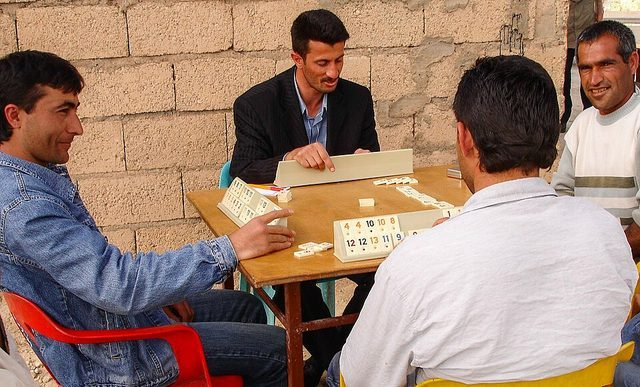

# Okey

*Also known as: Okey 101 is a variant · Turkish tile rummy*

**Encyclopedia ID 1158** (permanent) · https://bpupadhyaya.github.io/world-heritage-games-site/games/1158-okey/

*Photo: Patricia Cardet, [CC BY-SA 4.0](https://creativecommons.org/licenses/by-sa/4.0/), [source on Wikimedia Commons](https://commons.wikimedia.org/wiki/File:Okey-game-yukari-konak-3.jpg)*

Four-player rummy played with 106 numbered tiles and a wild joker tile; make runs, sets or seven pairs to go out.

## Heritage note

Part of the living heritage of Turkey, Cyprus.

## Origins

Usually placed in the era of Classical Worlds (about 1000 BCE to 500 CE), although its exact origins are uncertain, within the cultural world of Mesopotamia, Levant and Arabia.

## Facts

- **Where:** Turkey, Cyprus
- **Type:** Board and table games
- **Family:** Dominoes and tile games
- **Era:** [Classical Worlds](../../eras/classical/index.md) (uncertain)
- **Cradle:** [Mesopotamia, Levant and Arabia](../../cradles/mesopotamia-levant/index.md)
- **Region:** Middle East and North Africa
- **Players:** 4

## Play it

[About the game](https://bpupadhyaya.github.io/games-site/games/okey-tile-rummy-offline/) · [Google Play](https://play.google.com/store/apps/details?id=com.equalinformation.arcforge.shell) · [App Store](https://apps.apple.com/us/app/arcforge-world-heritage-games/id6813746442)

## Related entries

- [101 Okey](../../games/1166-101-okey/index.md)
- [Cirit](../../games/156-cirit/index.md)
- [Qanun](../../games/162-qanun/index.md)
- [Rummikub](../../games/826-rummikub/index.md)
- [Mahjong](../../games/635-mahjong/index.md)
- [Cafe dominoes](../../games/690-cafe-dominoes/index.md)

## Sources

- <https://en.wikipedia.org/wiki/Okey>
- <https://play.google.com/store/apps/details?id=com.ahoygames.okey&hl=en_US>
- <https://www.pagat.com/national/turkey.html>
