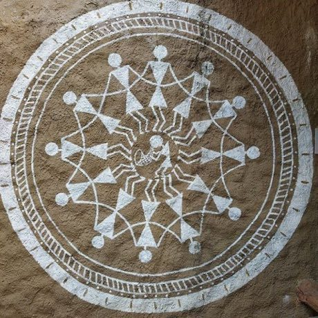

# Warli painting

*वारली*

**Encyclopedia ID 117** (permanent) · https://equalinformation.com/world-heritage-games-site/games/117-warli-painting/

*Photo: Omrmankar, [CC BY-SA 4.0](https://creativecommons.org/licenses/by-sa/4.0/), [source on Wikimedia Commons](https://commons.wikimedia.org/wiki/File:Warli_painting.jpg)*

Draw stick-figure scenes from circles, triangles and lines on a mud-wall canvas, completing village life scenes and ring dances.

## Heritage note

Part of the living heritage of India. Some forms of this practice carry deep meaning for the communities who keep it; here we describe the play and the craft only, with respect for its roots.

## Origins

A living tradition passed from person to person; it is not tied to a single dated origin. It belongs to the cultural world of South Asia.

## Facts

- **Where:** India
- **Type:** Crafts and making
- **Family:** Paper, ink and painting crafts
- **Era:** [Living Traditions](../../eras/living/index.md)
- **Cradle:** [South Asia](../../cradles/south-asia/index.md)
- **Region:** South and Central Asia

## Related entries

- [Pakistani truck art](../../games/116-pakistani-truck-art/index.md)
- [Block printing](../../games/118-block-printing/index.md)
- [Lippan kaam mud-and-mirror relief](../../games/259-lippan-kaam-mud-and-mirror-relief/index.md)
- [Mehndi henna pattern drawing](../../games/260-mehndi-henna-pattern-drawing/index.md)
- [Kashmiri papier-mache painting](../../games/269-kashmiri-papier-mache-painting/index.md)
- [Mithila folk painting](../../games/1337-mithila-folk-painting/index.md)

## Sources

- <https://commons.wikimedia.org/wiki/File:Warli_painting.jpg>
