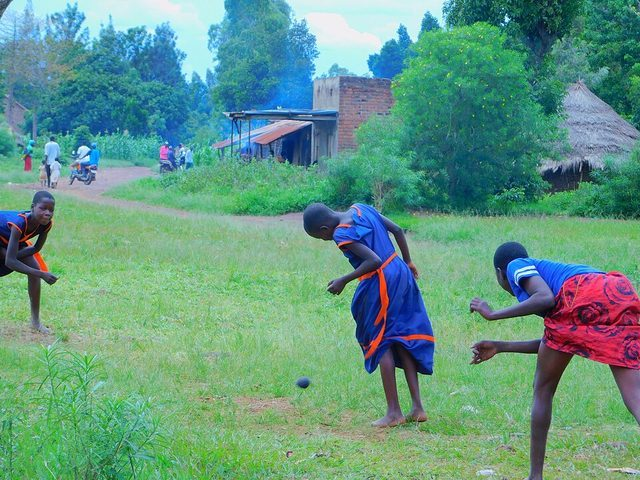

# Kwepena

**Encyclopedia ID 1174** (permanent) · https://bpupadhyaya.github.io/world-heritage-games-site/games/1174-kwepena/

*Photo: Nice Musana, [CC BY-SA 4.0](https://creativecommons.org/licenses/by-sa/4.0/), [source on Wikimedia Commons](https://commons.wikimedia.org/wiki/File:Playing_Kwepena.jpg)*

Buganda dodgeball with shooters at both ends.

## Heritage note

Part of the living heritage of Uganda.

## Origins

Usually placed in the era of Modern Heritage (1800 to today), although its exact origins are uncertain, within the cultural world of Africa: Great Lakes and Indian Ocean.

## Facts

- **Where:** Uganda
- **Type:** Street and playground games
- **Family:** Tag, chase and hide games
- **Era:** [Modern Heritage](../../eras/modern/index.md) (uncertain)
- **Cradle:** [Africa: Great Lakes and Indian Ocean](../../cradles/africa-east/index.md)
- **Region:** Sub-Saharan Africa
- **Players:** 2

## Related entries

- [Kho-Kho](../../games/15-kho-kho/index.md)
- [Cheese Rolling Hill](../../games/70-cheese-rolling-hill/index.md)
- [Otedama](../../games/131-otedama/index.md)
- [Blind Man's Buff](../../games/467-blind-mans-buff/index.md)
- [Hand-slap game](../../games/711-hand-slap-game/index.md)
- [Kabaddi](../../games/789-kabaddi/index.md)

## Sources

- <https://www.habariugandatours.com/uganda-safari-local-games/>
