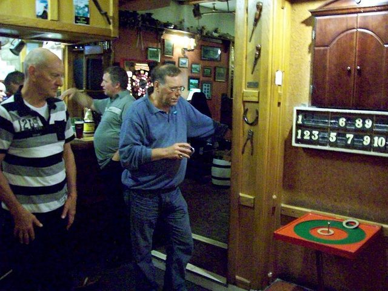

# Regional pub games

*Also known as: Bat and Trap · Aunt Sally · Toad in the Hole · Ringing the Bull*

**Encyclopedia ID 1180** (permanent) · https://bpupadhyaya.github.io/world-heritage-games-site/games/1180-regional-pub-games/

*Photo: Obscurasky, [Public domain](https://creativecommons.org/publicdomain/mark/1.0/), [source on Wikimedia Commons](https://commons.wikimedia.org/wiki/File:Indoor_Quoits.jpg)*

Regional pub and garden games: bat and trap (Kent), Aunt Sally (Oxfordshire), toad in the hole (Sussex), ringing the bull (Nottingham).

## Heritage note

Part of the living heritage of United Kingdom.

## Origins

Usually placed in the era of Age of Contact and Craft (about 1500 to 1800), although its exact origins are uncertain, within the cultural world of Celtic and Atlantic Europe.

## Facts

- **Where:** United Kingdom
- **Type:** Street and playground games
- **Family:** Horse and animal sports
- **Era:** [Age of Contact and Craft](../../eras/contact/index.md) (uncertain)
- **Cradle:** [Celtic and Atlantic Europe](../../cradles/celtic-atlantic/index.md)
- **Region:** Europe
- **Players:** 2-8

## Related entries

- [Pacu jawi](../../games/1354-pacu-jawi/index.md)
- [Bulls and Cows](../../games/9038-bulls-and-cows/index.md)
- [Candlepin bowling](../../games/444-candlepin-bowling/index.md)
- [Pub darts](../../games/1182-pub-darts/index.md)
- [Change Ringing](../../games/1443-change-ringing/index.md)
- [Skittles](../../games/1179-skittles/index.md)

## Sources

- <https://en.wikipedia.org/wiki/Pub_game>
