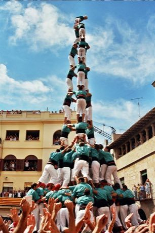

# Castells

*Also known as: Catalan human towers*

**Encyclopedia ID 119** (permanent) · https://bpupadhyaya.github.io/world-heritage-games-site/games/119-castells/

*Photo: Eric Sala & Tania Garcia, [CC BY-SA 2.5](https://creativecommons.org/licenses/by-sa/2.5/), [source on Wikimedia Commons](https://commons.wikimedia.org/wiki/3d10_fm_de_vilafranca.jpg)*

Castells is a puzzles and mind game tradition from Spain.

## Heritage note

Part of the living heritage of Spain.

## Origins

Usually placed in the era of Modern Heritage (1800 to today), although its exact origins are uncertain, within the cultural world of Mediterranean.

## Facts

- **Where:** Spain
- **Type:** Puzzles and mind games
- **Family:** Puzzle and dexterity toys
- **Era:** [Modern Heritage](../../eras/modern/index.md) (uncertain)
- **Cradle:** [Mediterranean](../../cradles/mediterranean/index.md)
- **Region:** Europe

## Play it

[Try a 90-second preview in your browser](https://bpupadhyaya.github.io/games-site/games/castells/play/) · [Google Play](https://play.google.com/store/apps/details?id=com.equalinformation.arcforge.shell) · App Store (coming soon)

## Related entries

- [Portolan Chart Navigator](../../games/503-portolan-chart-navigator/index.md)
- [Flag Tossing](../../games/395-flag-tossing/index.md)
- [Euclid's Ruler and Compass](../../games/396-euclids-ruler-and-compass/index.md)
- [Antikythera Gear Train](../../games/397-antikythera-gear-train/index.md)
- [Ghadames Rooftop Maze](../../games/1291-ghadames-rooftop-maze/index.md)
- [Kingyo-sukui](../../games/3-kingyo-sukui/index.md)

## Sources

- <https://commons.wikimedia.org/wiki/3d10_fm_de_vilafranca.jpg>
