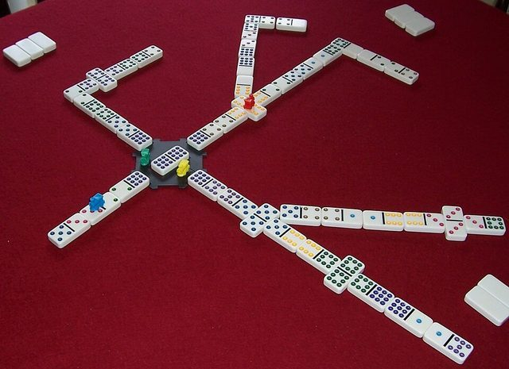

# Chickenfoot

*Also known as: Train Dominoes · Mexican Train*

**Encyclopedia ID 1193** (permanent) · https://bpupadhyaya.github.io/world-heritage-games-site/games/1193-chickenfoot/

*Photo: Liko81, [CC BY 3.0](https://creativecommons.org/licenses/by/3.0/), [source on Wikimedia Commons](https://commons.wikimedia.org/wiki/File:Mexican_Train.jpg)*

Spinner-hub family domino games where players build branching lines; Chickenfoot adds forked 'feet'.

## Heritage note

Part of the living heritage of United States.

## Origins

Usually placed in the era of Crossroads and Golden Ages (about 500 to 1500), although its exact origins are uncertain, within the cultural world of The Americas: North America.

## Facts

- **Where:** United States
- **Type:** Board and table games
- **Family:** Dominoes and tile games
- **Era:** [Crossroads and Golden Ages](../../eras/crossroads/index.md) (uncertain)
- **Cradle:** [The Americas: North America](../../cradles/north-america/index.md)
- **Region:** Americas
- **Players:** 2-8

## Related entries

- [Texas 42](../../games/1195-texas-42/index.md)
- [Mahjong](../../games/635-mahjong/index.md)
- [Cafe dominoes](../../games/690-cafe-dominoes/index.md)
- [Rummikub](../../games/826-rummikub/index.md)
- [Riichi mahjong](../../games/851-riichi-mahjong/index.md)
- [Bahamian dominoes](../../games/569-bahamian-dominoes/index.md)

## Sources

- <https://en.wikipedia.org/wiki/Mexican_Train>
