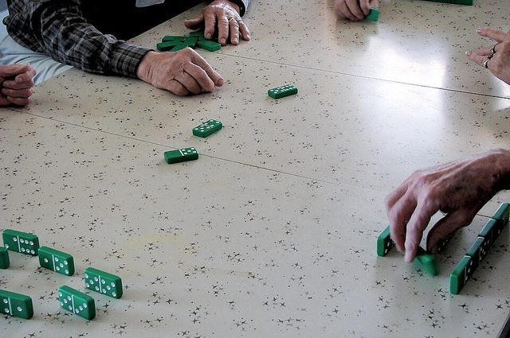

# Texas 42

*Also known as: Dominoes: Texas 42 · Forty-Two · 42*

**Encyclopedia ID 1195** (permanent) · https://bpupadhyaya.github.io/world-heritage-games-site/games/1195-texas-42/

*Photo: Loadmaster (David R. Tribble), [CC BY-SA 3.0](https://creativecommons.org/licenses/by-sa/3.0/), [source on Wikimedia Commons](https://commons.wikimedia.org/wiki/File:Dominoes84.jpg)*

Partnership trick-taking game played with dominoes instead of cards; invented 1887 in Texas.

## Heritage note

Part of the living heritage of United States.

## Origins

Usually placed in the era of Crossroads and Golden Ages (about 500 to 1500), although its exact origins are uncertain, within the cultural world of The Americas: North America.

## Facts

- **Where:** United States
- **Type:** Board and table games
- **Family:** Dominoes and tile games
- **Era:** [Crossroads and Golden Ages](../../eras/crossroads/index.md) (uncertain)
- **Cradle:** [The Americas: North America](../../cradles/north-america/index.md)
- **Region:** Americas
- **Players:** 4 (2v2)

## Related entries

- [Chickenfoot](../../games/1193-chickenfoot/index.md)
- [Mahjong](../../games/635-mahjong/index.md)
- [Cafe dominoes](../../games/690-cafe-dominoes/index.md)
- [Rummikub](../../games/826-rummikub/index.md)
- [Riichi mahjong](../../games/851-riichi-mahjong/index.md)
- [Bahamian dominoes](../../games/569-bahamian-dominoes/index.md)

## Sources

- <https://www.tshaonline.org/handbook/entries/forty-two-domino-game>
- <https://texashighways.com/state-symbols/the-texas-state-domino-game-42/>
