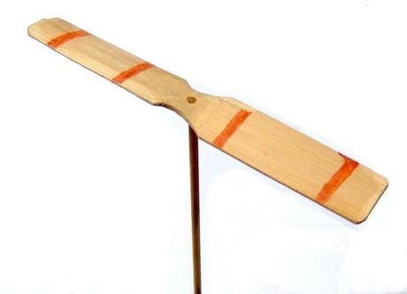

# Bamboo Copter

*Also known as: Taketombo · Zhuzhu*

**Encyclopedia ID 12** (permanent) · https://bpupadhyaya.github.io/world-heritage-games-site/games/12-bamboo-copter/

*Photo: Haragayato, [CC BY-SA 2.5](https://creativecommons.org/licenses/by-sa/2.5/), [source on Wikimedia Commons](https://commons.wikimedia.org/wiki/File:Taketombo.JPG)*

Spin the shaft between your palms and release; adjust spin strength and angle to fly the little propeller as far or as high as possible.

## Heritage note

A tradition shared by communities in many places.

## Origins

Usually placed in the era of Modern Heritage (1800 to today), although its exact origins are uncertain.

## Facts

- **Where:** Shared across many places
- **Type:** Toys
- **Era:** [Modern Heritage](../../eras/modern/index.md) (uncertain)
- **Cradle:** [Shared across the world](../../cradles/worldwide/index.md)
- **Region:** East and Southeast Asia

## Play it

[Web preview](https://bpupadhyaya.github.io/) · [Google Play](https://play.google.com/store/apps/details?id=com.equalinformation.arcforge.shell) · [App Store](https://apps.apple.com/us/app/arcforge-world-heritage-games/id6813746442)

## Sources

- <https://commons.wikimedia.org/wiki/File:Taketombo.JPG>
