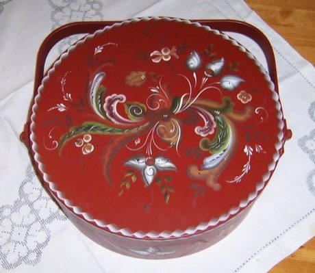

# Rosemaling

*Also known as: Norwegian decorative painting*

**Encyclopedia ID 120** (permanent) · https://bpupadhyaya.github.io/world-heritage-games-site/games/120-rosemaling/

*Photo: Erik A. Drablos, [CC BY-SA 2.5](https://creativecommons.org/licenses/by-sa/2.5/), [source on Wikimedia Commons](https://commons.wikimedia.org/wiki/Rosemaling.jpg)*

Choose a bowl or box and paint C-scrolls, flowers and leaves along guide curves with a drawn brush stroke, judged on flow.

## Heritage note

Part of the living heritage of Norway.

## Origins

A living tradition passed from person to person; it is not tied to a single dated origin. It belongs to the cultural world of Northern and Eastern Europe.

## Facts

- **Where:** Norway
- **Type:** Crafts and making
- **Family:** Paper, ink and painting crafts
- **Era:** [Living Traditions](../../eras/living/index.md)
- **Cradle:** [Northern and Eastern Europe](../../cradles/north-east-europe/index.md)
- **Region:** Europe

## Related entries

- [Matryoshka](../../games/28-matryoshka/index.md)
- [Khokhloma Pattern Painting](../../games/102-khokhloma-pattern-painting/index.md)
- [Petrykivka painting](../../games/381-petrykivka-painting/index.md)
- [Kalocsa floral painting](../../games/383-kalocsa-floral-painting/index.md)
- [Dala Horse Painting](../../games/415-dala-horse-painting/index.md)
- [Paper Soccer](../../games/464-paper-soccer/index.md)

## Sources

- <https://commons.wikimedia.org/wiki/Rosemaling.jpg>
