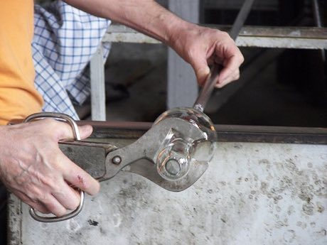

# Glassblowing

*Soffiatura del vetro · Venetian style*

**Encyclopedia ID 121** (permanent) · https://bpupadhyaya.github.io/world-heritage-games-site/games/121-glassblowing/

*Photo: Wknight94, [CC BY-SA 3.0](https://creativecommons.org/licenses/by-sa/3.0/), [source on Wikimedia Commons](https://commons.wikimedia.org/wiki/Murano_glassblowing_demo_2.jpg)*

Gather molten glass, then blow, spin, pinch and pull with timed gestures to form a goblet or vase to match the shape.

## Heritage note

Part of the living heritage of Italy.

## Origins

A living tradition passed from person to person; it is not tied to a single dated origin. It belongs to the cultural world of Mediterranean.

## Facts

- **Where:** Italy
- **Type:** Crafts and making
- **Family:** Pottery, wood and metal crafts
- **Era:** [Living Traditions](../../eras/living/index.md)
- **Cradle:** [Mediterranean](../../cradles/mediterranean/index.md)
- **Region:** Europe

## Related entries

- [Tessellated Mosaic Making](../../games/500-tessellated-mosaic-making/index.md)
- [Zellij tile mosaic](../../games/21-zellij-tile-mosaic/index.md)
- [Azulejo tile painting](../../games/122-azulejo-tile-painting/index.md)
- [Txalaparta Duet](../../games/390-txalaparta-duet/index.md)
- [Swahili carved door](../../games/90-swahili-carved-door/index.md)
- [Thai fruit and vegetable carving](../../games/114-thai-fruit-and-vegetable-carving/index.md)

## Sources

- <https://commons.wikimedia.org/wiki/Murano_glassblowing_demo_2.jpg>
