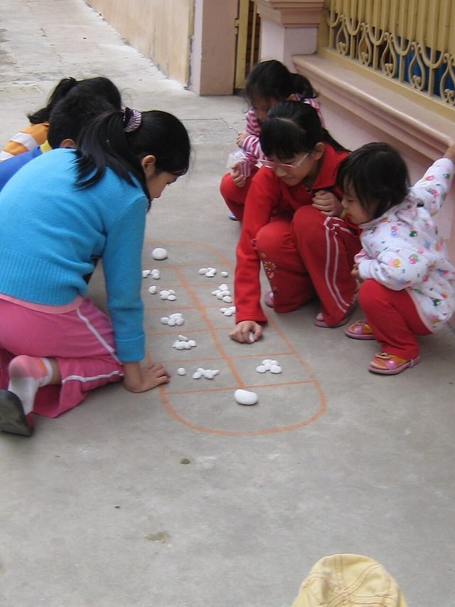

# Mandarin square capturing

*Also known as: O An Quan*

**Encyclopedia ID 1216** (permanent) · https://bpupadhyaya.github.io/world-heritage-games-site/games/1216-mandarin-square-capturing/

*Photo: Tieu ngao giang ho1970, [Public domain](https://creativecommons.org/publicdomain/mark/1.0/), [source on Wikimedia Commons](https://commons.wikimedia.org/wiki/File:Oanquan0.JPG)*

Mancala game drawn on the ground; capture mandarin pieces and pebbles.

## Heritage note

Part of the living heritage of Vietnam.

## Origins

Usually placed in the era of Deep Past and First Games (before about 3000 BCE), although its exact origins are uncertain, within the cultural world of Southeast Asia and the Islands.

## Facts

- **Where:** Vietnam
- **Type:** Board and table games
- **Family:** Mancala and sowing games
- **Era:** [Deep Past and First Games](../../eras/deep-past/index.md) (uncertain)
- **Cradle:** [Southeast Asia and the Islands](../../cradles/southeast-asia/index.md)
- **Region:** East and Southeast Asia
- **Players:** 2

## Play it

[Try a 90-second preview in your browser](https://bpupadhyaya.github.io/games-site/games/o-an-quan-mandarin-squares/play/) · [Google Play](https://play.google.com/store/apps/details?id=com.equalinformation.arcforge.shell) · [App Store](https://apps.apple.com/us/app/arcforge-world-heritage-games/id6813746442)

## Related entries

- [Congklak](../../games/803-congklak/index.md)
- [Sungka](../../games/1025-sungka/index.md)
- [Songo](../../games/617-songo/index.md)
- [Bao](../../games/647-bao/index.md)
- [Kisolo](../../games/666-kisolo/index.md)
- [Oware](../../games/749-oware/index.md)

## Sources

- <https://vinwonders.com/en/wonderpedia/news/traditional-vietnamese-games/>
- <https://en.wikipedia.org/wiki/Ô_ăn_quan>
