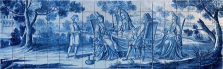

# Azulejo tile painting

*Also known as: Azulejo*

**Encyclopedia ID 122** (permanent) · https://bpupadhyaya.github.io/world-heritage-games-site/games/122-azulejo-tile-painting/

*Photo: Alvesgaspar, [CC BY-SA 3.0](https://creativecommons.org/licenses/by-sa/3.0/), [source on Wikimedia Commons](https://commons.wikimedia.org/wiki/Azulejo_December_2012-8a.jpg)*

Place and paint blue-and-white tiles so a panel pattern or scene lines up across a wall.

## Heritage note

Part of the living heritage of Portugal. Some forms of this practice carry deep meaning for the communities who keep it; here we describe the play and the craft only, with respect for its roots.

## Origins

A living tradition passed from person to person; it is not tied to a single dated origin. It belongs to the cultural world of Mediterranean.

## Facts

- **Where:** Portugal
- **Type:** Crafts and making
- **Family:** Pottery, wood and metal crafts
- **Era:** [Living Traditions](../../eras/living/index.md)
- **Cradle:** [Mediterranean](../../cradles/mediterranean/index.md)
- **Region:** Europe

## Related entries

- [Zellij tile mosaic](../../games/21-zellij-tile-mosaic/index.md)
- [Glassblowing](../../games/121-glassblowing/index.md)
- [Txalaparta Duet](../../games/390-txalaparta-duet/index.md)
- [Tessellated Mosaic Making](../../games/500-tessellated-mosaic-making/index.md)
- [Swahili carved door](../../games/90-swahili-carved-door/index.md)
- [Thai fruit and vegetable carving](../../games/114-thai-fruit-and-vegetable-carving/index.md)

## Sources

- <https://commons.wikimedia.org/wiki/Azulejo_December_2012-8a.jpg>
