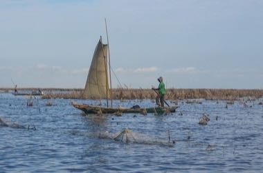

# Acadja Fish Park

*Also known as: Acadja · Lake Nokoué*

**Encyclopedia ID 1223** (permanent) · https://bpupadhyaya.github.io/world-heritage-games-site/games/1223-acadja-fish-park/

*Photo: jbdodane, [CC BY 2.0](https://creativecommons.org/licenses/by/2.0/), [source on Wikimedia Commons](https://commons.wikimedia.org/wiki/File:Acadja_of_Ganvi%C3%A9.jpg)*

Plant branch fences in shallow lagoon water so fish gather and breed, then harvest at the right moment, balancing growth, currents and neighbouring parks.

## Heritage note

Part of the living heritage of Benin.

## Origins

Usually placed in the era of Crossroads and Golden Ages (about 500 to 1500), although its exact origins are uncertain, within the cultural world of Africa: Sahel, West and Central.

## Facts

- **Where:** Benin
- **Type:** Board and table games
- **Era:** [Crossroads and Golden Ages](../../eras/crossroads/index.md) (uncertain)
- **Cradle:** [Africa: Sahel, West and Central](../../cradles/africa-west/index.md)
- **Region:** Sub-Saharan Africa

## Related entries

- [Yote Capture Grid](../../games/167-yote-capture-grid/index.md)
- [Sahel Salt Caravan](../../games/172-sahel-salt-caravan/index.md)
- [Queah](../../games/885-queah/index.md)
- [Balanta Mangrove Rice Polder](../../games/1235-balanta-mangrove-rice-polder/index.md)
- [Vai Syllabary Decoder](../../games/1394-vai-syllabary-decoder/index.md)
- [Nzango](../../games/1422-nzango/index.md)

## Sources

- <https://commons.wikimedia.org/wiki/File:Acadja_of_Ganvi%C3%A9.jpg>
