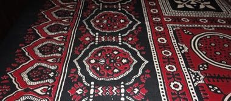

# Ajrak block printing

*اجرک*

**Encyclopedia ID 1226** (permanent) · https://equalinformation.com/world-heritage-games-site/games/1226-ajrak-block-printing/

*Photo: Ahub1988, [CC BY-SA 3.0](https://creativecommons.org/licenses/by-sa/3.0/), [source on Wikimedia Commons](https://commons.wikimedia.org/wiki/File:Ajrak.jpg)*

Stamp a wooden block in resist paste, dye in indigo and madder red, and wash to reveal the dense geometric border-and-centre pattern.

## Heritage note

Part of the living heritage of Pakistan. Some forms of this practice carry deep meaning for the communities who keep it; here we describe the play and the craft only, with respect for its roots.

## Origins

A living tradition passed from person to person; it is not tied to a single dated origin. It belongs to the cultural world of South Asia.

## Facts

- **Where:** Pakistan
- **Type:** Crafts and making
- **Family:** Paper, ink and painting crafts
- **Era:** [Living Traditions](../../eras/living/index.md)
- **Cradle:** [South Asia](../../cradles/south-asia/index.md)
- **Region:** South and Central Asia

## Related entries

- [Pakistani truck art](../../games/116-pakistani-truck-art/index.md)
- [Lippan kaam mud-and-mirror relief](../../games/259-lippan-kaam-mud-and-mirror-relief/index.md)
- [Mehndi henna pattern drawing](../../games/260-mehndi-henna-pattern-drawing/index.md)
- [Warli painting](../../games/117-warli-painting/index.md)
- [Block printing](../../games/118-block-printing/index.md)
- [Kashmiri papier-mache painting](../../games/269-kashmiri-papier-mache-painting/index.md)

## Sources

- <https://commons.wikimedia.org/wiki/File:Ajrak.jpg>
