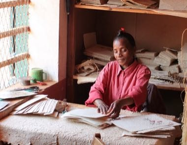

# Antaimoro flower paper

*Antaimoro flower paper*

**Encyclopedia ID 1229** (permanent) · https://bpupadhyaya.github.io/world-heritage-games-site/games/1229-antaimoro-flower-paper/

*Photo: Heinonlein, [CC BY-SA 4.0](https://creativecommons.org/licenses/by-sa/4.0/), [source on Wikimedia Commons](https://commons.wikimedia.org/wiki/File:Antaimoro-papier,_Ambalavao_05_(cropped).JPG)*

Beat bark pulp into a sheet, press real flowers and leaves in a pattern, and dry it to make decorative paper.

## Heritage note

Part of the living heritage of Madagascar.

## Origins

A living tradition passed from person to person; it is not tied to a single dated origin. It belongs to the cultural world of Africa: Great Lakes and Indian Ocean.

## Facts

- **Where:** Madagascar
- **Type:** Crafts and making
- **Family:** Paper, ink and painting crafts
- **Era:** [Living Traditions](../../eras/living/index.md)
- **Cradle:** [Africa: Great Lakes and Indian Ocean](../../cradles/africa-east/index.md)
- **Region:** Sub-Saharan Africa

## Related entries

- [Imigongo geometric painting](../../games/182-imigongo-geometric-painting/index.md)
- [Tingatinga painting](../../games/183-tingatinga-painting/index.md)
- [Kanga cloth design](../../games/184-kanga-cloth-design/index.md)
- [Ebru paper marbling](../../games/20-ebru-paper-marbling/index.md)
- [Ndebele geometric wall painting](../../games/23-ndebele-geometric-wall-painting/index.md)
- [Chinese knotting](../../games/26-chinese-knotting/index.md)

## Sources

- <https://commons.wikimedia.org/wiki/File:Antaimoro-papier,_Ambalavao_05_(cropped).JPG>
