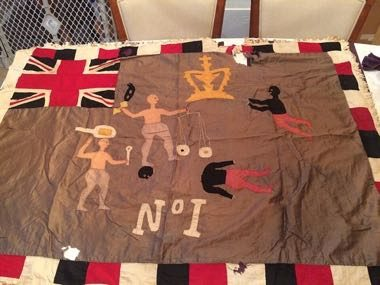

# Asafo Flag Appliqué

*Asafo flags*

**Encyclopedia ID 1230** (permanent) · https://equalinformation.com/world-heritage-games-site/games/1230-asafo-flag-applique/

*Photo: Lucasliso, [CC BY-SA 4.0](https://creativecommons.org/licenses/by-sa/4.0/), [source on Wikimedia Commons](https://commons.wikimedia.org/wiki/File:Asafo_no_1_company_flag.jpg)*

Stitch cut fabric figures (ships, animals, crowns, anchors) on a square flag to match a motto-picture card, then compare against rival company designs.

## Heritage note

Part of the living heritage of Ghana. Some forms of this practice carry deep meaning for the communities who keep it; here we describe the play and the craft only, with respect for its roots. It is presented as sport and skill, never as real fighting.

## Origins

A living tradition passed from person to person; it is not tied to a single dated origin. It belongs to the cultural world of Africa: Sahel, West and Central.

## Facts

- **Where:** Ghana
- **Type:** Crafts and making
- **Family:** Paper, ink and painting crafts
- **Era:** [Living Traditions](../../eras/living/index.md)
- **Cradle:** [Africa: Sahel, West and Central](../../cradles/africa-west/index.md)
- **Region:** Sub-Saharan Africa

## Related entries

- [Adinkra Cloth Stamping](../../games/170-adinkra-cloth-stamping/index.md)
- [Bogolan mud cloth](../../games/86-bogolan-mud-cloth/index.md)
- [Kuba cloth pattern puzzle](../../games/91-kuba-cloth-pattern-puzzle/index.md)
- [Tiebele House Painting](../../games/174-tiebele-house-painting/index.md)
- [Dahomey Appliqué Panel Studio](../../games/1262-dahomey-applique-panel-studio/index.md)
- [Dakar Car Rapide Livery Painter](../../games/1263-dakar-car-rapide-livery-painter/index.md)

## Sources

- <https://commons.wikimedia.org/wiki/File:Asafo_no_1_company_flag.jpg>
