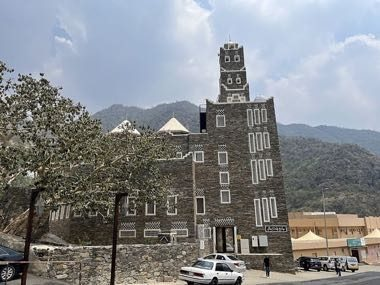

# Al-Qatt Al-Asiri Wall Painting

*القط العسيري*

**Encyclopedia ID 1231** (permanent) · https://bpupadhyaya.github.io/world-heritage-games-site/games/1231-al-qatt-al-asiri-wall-painting/

*Photo: Shijan Kaakkara, [CC BY-SA 4.0](https://creativecommons.org/licenses/by-sa/4.0/), [source on Wikimedia Commons](https://commons.wikimedia.org/wiki/File:Rojal_Heritage_Village_-_Rijal_Almaa_Heritage_Village,_Asir,_Saudi_Arabia-3.jpg)*

Women of Asir paint bold geometric bands on house walls; the player repeats and mirrors colour bands and triangles to complete a room's mural to a template.

## Heritage note

Part of the living heritage of Saudi Arabia.

## Origins

A living tradition passed from person to person; it is not tied to a single dated origin. It belongs to the cultural world of Mesopotamia, Levant and Arabia.

## Facts

- **Where:** Saudi Arabia
- **Type:** Crafts and making
- **Family:** Paper, ink and painting crafts
- **Era:** [Living Traditions](../../eras/living/index.md)
- **Cradle:** [Mesopotamia, Levant and Arabia](../../cradles/mesopotamia-levant/index.md)
- **Region:** Middle East and North Africa

## Related entries

- [Ebru paper marbling](../../games/20-ebru-paper-marbling/index.md)
- [Jordanian Sand Bottle Art](../../games/219-jordanian-sand-bottle-art/index.md)
- [Keffiyeh Pattern Loom](../../games/1310-keffiyeh-pattern-loom/index.md)
- [Qamariya Gypsum Window Designer](../../games/1368-qamariya-gypsum-window-designer/index.md)
- [Ndebele geometric wall painting](../../games/23-ndebele-geometric-wall-painting/index.md)
- [Chinese knotting](../../games/26-chinese-knotting/index.md)

## Sources

- <https://commons.wikimedia.org/wiki/File:Rojal_Heritage_Village_-_Rijal_Almaa_Heritage_Village,_Asir,_Saudi_Arabia-3.jpg>
