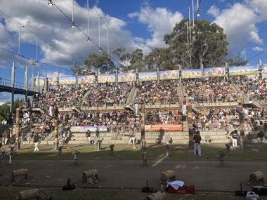

# Axemen woodchop

*Woodchopping · also spelled wood-chopping or wood chopping · standing block and underhand*

**Encyclopedia ID 1232** (permanent) · https://equalinformation.com/world-heritage-games-site/games/1232-axemen-woodchop/

*Photo: Thiscouldbeauser, [CC BY-SA 4.0](https://creativecommons.org/licenses/by-sa/4.0/), [source on Wikimedia Commons](https://commons.wikimedia.org/wiki/File:Woodchopping_state_rivalry.jpg)*

Time swings to chop a log into two cleanly in the shortest number of strokes, adjusting stance and rhythm; compete in knockout heats.

## Heritage note

Part of the living heritage of Australia.

## Origins

Usually placed in the era of Modern Heritage (1800 to today), although its exact origins are uncertain, within the cultural world of Pacific and Oceania.

## Facts

- **Where:** Australia
- **Type:** Other traditions
- **Era:** [Modern Heritage](../../eras/modern/index.md) (uncertain)
- **Cradle:** [Pacific and Oceania](../../cradles/pacific/index.md)
- **Region:** Oceania and Pacific

## Related entries

- [Netball](../../games/447-netball/index.md)
- [Woggabaliri](../../games/561-woggabaliri/index.md)
- [Wave riding](../../games/76-wave-riding/index.md)
- [Gumboot throwing](../../games/448-gumboot-throwing/index.md)
- [Marshallese stick chart navigator](../../games/1333-marshallese-stick-chart-navigator/index.md)
- [Sand drawing](../../games/1395-sand-drawing/index.md)

## Sources

- <https://commons.wikimedia.org/wiki/File:Woodchopping_state_rivalry.jpg>
- <https://en.wikipedia.org/wiki/Woodchopping>
